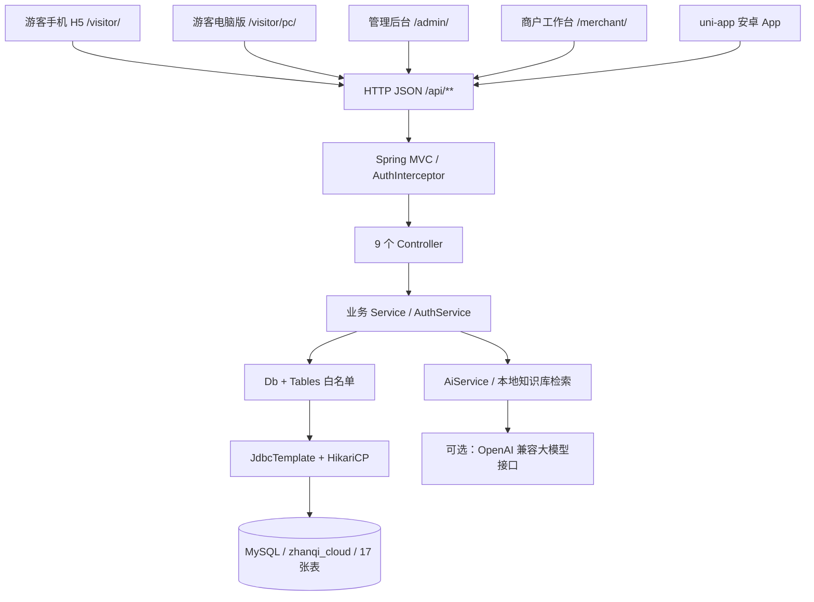
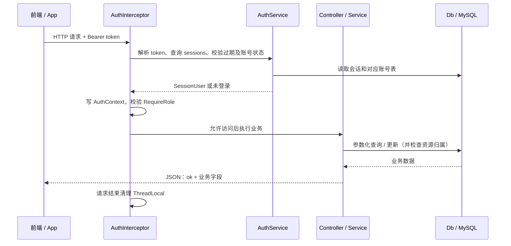

# 郫都区战旗村 · 川西林盘农商文旅智慧服务平台

> 一套面向乡村振兴场景的农商文旅一体化平台。**一台电脑当服务器**，PC 管理后台、商户工作台、游客手机/电脑版 H5 与安卓 App 共用一个后端。
> 后端 SpringBoot + MySQL，AI 采用本地知识库与可选第三方大模型；未配置或第三方调用失败时回退本地回答。

---

## 阅读导航

- [一键部署、地址与默认账号](#quick-start)
- [后端架构、启动顺序与请求链路](#backend-architecture)
- [目录结构](#project-layout) · [功能清单](#features)
- [数据库完整参考：17 张表、224 个字段、全部索引与逻辑关系](#database-reference)
- [游客端说明](#visitor-guide) · [AI 能力](#ai-guide)
- [全部 HTTP 接口：权限、参数、响应与示例](#api-reference)
- [常见问题](#faq) · [环境要求](#requirements) · [演示顺序](#demo) · [已知边界](#limitations)

> 本文按当前控制器、业务服务、`schema.sql` 与 `Tables.java` 整理；接口和数据结构变更时需同步维护。
> 部署章节使用默认 8080 演示，实际端口以启动输出为准。文中密码仅为公开演示账号，不包含成员本机口令或真实密钥。

---

<a id="quick-start"></a>

## 一、一键部署

### Windows

| 步骤 | 操作 | 说明 |
| --- | --- | --- |
| 1 | 确认电脑装了 **JDK 17+** 和 **MySQL** | 命令行 `java -version` 能看到 17 以上；MySQL 服务已启动 |
| 2 | 双击 **`一键部署.bat`** | 脚本自动完成：检查环境 → 探测数据库口令 → 建库建表灌演示数据 → 后台启动服务 → 打开浏览器 |
| 3 | 浏览器里打开打印出来的地址即可 | 部署完成后控制台会列出四组地址（见下表） |

**不需要装 Node.js、不需要装 Maven、不需要手工执行 SQL、不需要配任何连接串。**
运行包 `dist/zhanqi-cloud-server.jar` 已经预编译好，双击即可。

> 如果双击后窗口一闪而过，说明批处理文件被改坏了。执行 `node tools/normalize-scripts.js --check` 可以查出原因。

### macOS / Linux

前提同样只有 **JDK 17+** 和 **MySQL**（macOS 可用 `brew install --cask temurin@17` 和 `brew services start mysql`），在项目根目录执行：

```bash
./deploy.sh      # 一键部署并启动，等价于 Windows 的「一键部署.bat」
./stop.sh        # 停止服务
./status.sh      # 查看运行状态与各端地址
./rebuild.sh     # 重新编译后端（需要 Maven，改了 Java 代码才需要）
./reset.sh       # 清空业务数据并重灌演示数据（需输入 YES 确认，不可恢复）
```

> 如果提示没有执行权限，先执行 `chmod +x *.sh tools/deploy.sh`，或直接用 `bash deploy.sh`。
> 两个平台的脚本行为完全对等（同样的口令探测、找空闲端口、后台运行、失败给人话提示）。

### 部署后的访问地址

| 端 | 地址 | 运行环境 |
| --- | --- | --- |
| **PC 管理后台** | `http://localhost:8080/admin/` | Chrome / Edge 等主流 PC 浏览器 |
| **商户工作台** | `http://localhost:8080/merchant/` | 电脑浏览器（H5 页面） |
| **游客端 H5** | `http://localhost:8080/visitor/` | 电脑浏览器 + 手机浏览器 |
| **统一入口页** | `http://localhost:8080/` | 含手机端二维码，扫码直达游客端 |
| **游客电脑版 H5** | `http://localhost:8080/visitor/pc/` | 电脑浏览器；`/visitor/` 会按设备判断跳转 |
| **安卓 App** | 由 `uniapp-visitor/` 工程打包，见第六节 | 安卓手机 |

> 手机访问要用**局域网地址**（形如 `http://192.168.x.x:8080/visitor/`），部署脚本会打印出来，入口页也有二维码。
> 前提是手机和电脑连同一个 WiFi。

### 默认账号

| 角色 | 账号 | 密码 | 说明 |
| --- | --- | --- | --- |
| 平台管理员 | `admin` | `admin123` | 系统预置，不开放注册 |
| 商家 | `zhangmm` | `123456` | 战旗米坊 · 张桂芬（农产品农户） |
| 商家 | `lims` | `123456` | 唐昌布鞋工坊 · 李长明（非遗手艺人） |
| 商家 | `liujg` | `123456` | 林盘小院民宿 · 刘建国（民宿经营者） |
| 游客 | `wangyou` | `123456` | 游客 小王 |
| 游客 | `lixue` | `123456` | 游客 李同学 |

> **登录页初始不显示任何账号**，这是刻意设计：只有「存在 + 成功登录过至少一次」两个条件都满足，账号才会出现在快捷登录卡片里，
> 避免任何人打开登录页就能看到平台有哪些账号。演示时手动输入一次即可，之后它会自己出现。

### 其他运维脚本

| 文件 | 作用 |
| --- | --- |
| `一键部署.bat` / `deploy.bat` | 启动服务（含首次部署的全部初始化，Windows） |
| `stop.bat` | 停止服务（Windows） |
| `status.bat` | 查看进程状态、健康检查结果与各端地址（Windows） |
| `rebuild.bat` | 重新编译后端（改了 Java 代码后才需要，需要 Maven，Windows） |
| `reset.bat` | 清空业务数据并重灌演示数据（需输入 YES 确认，Windows） |
| `deploy.sh` / `stop.sh` / `status.sh` / `rebuild.sh` / `reset.sh` | 上述脚本的 macOS / Linux 版，行为完全对等 |
| `tools/deploy.ps1` | Windows 批处理的实际逻辑（可直接阅读，注释很详细） |
| `tools/deploy.sh` | macOS / Linux 脚本的实际逻辑，与 deploy.ps1 保持行为对等 |
| `tools/build.ps1` | 编译后端并把产物同步到 `dist/`（Windows） |
| `tools/normalize-scripts.js` | 校验脚本编码（`.bat` 必须 CRLF + 纯 ASCII，`.ps1` 必须 UTF-8 BOM，`.sh` 必须 LF 无 BOM） |

### 自检脚本（改完代码跑一遍）

| 命令 | 作用 |
| --- | --- |
| `node tools/smoke-test.js` | **接口冒烟测试**：141 项断言，覆盖认证、打卡、四类商品下单、拒绝协商、发货物流、聊天、举报与上诉、退款、AI 问答与防幻觉、权限矩阵、服务器管理，外加一条「图片引用是否都存在」的静态检查 |
| `node tools/browser-check.js` | **前端实机自检**：52 项断言，用本机 Chrome 无头模式把四端页面真的跑一遍，抓未捕获异常、控制台错误、所有 4xx/5xx 请求，并对关键 DOM 做断言（含集章扇形图三条硬断言、语音启停回归）；顺带产出 `docs/screenshots/` 截图 |
| `node tools/deploy-config-test.js` | **部署配置解析回归测试**：36 项断言。从交付版 `deploy.ps1` / `deploy.sh` 里把读配置的函数**抽出来原样执行**（不是复制一份实现），守住「`app.port` 与 `app.database.port` 同名 `port` 导致配置被写坏」那个老坑 —— 它首次部署不发作、第二次起才发作，Windows 与 macOS 两侧都被独立踩到过 |
| `node tools/normalize-scripts.js --check` | 脚本编码自检（可挂到提交前钩子） |

> 冒烟测试与浏览器自检会用测试账号往数据库里写数据。账号与商品会自动清理；**订单会保留** ——
> 订单是交易凭证，后台刻意不开放直接删除，脚本会在结尾提醒你。
> 正式演示前按下面的「想清空演示数据重新开始？」重置一次即可。
>
> 这些脚本都不依赖任何 npm 包（浏览器自检走的是 Chrome DevTools Protocol + Node 内置 WebSocket），
> 所以在完全离线的机器上也能跑。

---

<a id="backend-architecture"></a>

## 二、后端架构与运行原理

### 2.1 部署拓扑与技术栈

后端是 **Spring Boot 3.3.5 / Java 17 的单体应用**，打成一个带内嵌 Tomcat 的 fat jar。
同一个进程托管页面、提供 REST API、初始化 MySQL，并提供局域网发现与二维码。
默认 HTTP 端口为 8080；部署脚本遇到占用会选择空闲端口，以终端实际输出为准。



| 层面 | 实际实现 | 说明 |
| --- | --- | --- |
| Web | Spring MVC、内嵌 Tomcat、Jackson | 9 个控制器、76 个映射方法，展开健康检查别名后为 **77 个 HTTP 方法 + 路径组合**；见第八节逐项清单 |
| 业务 | `service/` + `auth/AuthService` | 账号、旅游点位、活动预约、交易、统计、AI、配置和服务信息；没有独立微服务 |
| 数据访问 | Spring JDBC `JdbcTemplate` + `db/Db` | 直接查询/更新 MySQL；无 MyBatis、JPA、Redis，**没有“整库启动加载 + 内存写穿缓存”** |
| 连接池 | HikariCP + MySQL Connector/J | 默认最大 8 个连接、最小空闲 1 个，取连接超时 8000ms |
| 静态页面 | `resources/static/`，本地 Vue 2.7 / Element UI | 管理端、商户端、游客手机 H5、游客电脑版均是手写零构建页面；本地 vendors 保证内网可用 |
| App 工程 | `uniapp-visitor/`，Vue 3 + Vite + uni-app | 保留独立的 H5/App 源码工程；**不是当前 `static/visitor/` 的构建来源**，两套界面功能需分别维护 |
| AI 与二维码 | JDK `HttpClient`、ZXing 3.5.3 | AI 使用可选外部 HTTP 服务；二维码由后端本地生成，不依赖二维码网站 |
| 部署 | `.bat` → `tools/deploy.ps1`；`.sh` → `tools/deploy.sh` | 普通部署只需要 JDK + MySQL；Node、Maven 仅用于自检或开发构建 |

源码依据：[启动类](server/src/main/java/com/zhanqi/cloud/ZhanqiCloudApplication.java)、
[依赖清单](server/pom.xml)、[Web 配置](server/src/main/java/com/zhanqi/cloud/config/WebConfig.java)。

### 2.2 各层职责与依赖方向

| 包 / 核心类 | 职责 | 依赖或使用者 |
| --- | --- | --- |
| `ZhanqiCloudApplication` | Spring Boot 入口，扫描和装配组件 | `java -jar` 启动 |
| `config/AppProperties` | 绑定 `app.*`：数据库、会话期限、AI 等基础参数 | 自举、连接池、认证和 AI |
| `config/PortGuard` | 固定实际监听端口，防止环境中的 `SERVER_PORT` 等变量意外覆盖 | 内嵌 Tomcat 启动配置 |
| `config/WebConfig` | 注册 `/api/**` 鉴权、跨域规则及静态目录首页转发 | Spring MVC |
| `auth/AuthInterceptor`、`RequireRole` | 解析会话，按方法/类上的角色注解检查访问权限 | 所有进入 MVC 的 API 请求 |
| `auth/AuthContext`、`SessionUser` | 用 ThreadLocal 保存本次请求的用户；请求完成后清理 | 控制器及服务的权限、归属检查 |
| `auth/AuthService`、`Accounts` | 注册、普通/快捷登录、会话、公开资料、头像和改密；账号规则与脱敏 | `AuthController`、管理服务 |
| `controller/` | 解析 path/query/JSON body，声明角色，调用服务并组装响应 | 各端通过 HTTP 调用 |
| `service/TourService` | 点位、集章、活动详情、活动预约/取消和人数统计 | `TourController` |
| `service/ShopService` | 商品维护、按商品拆单、库存/销量变更、确认/拒绝协商/发货/完成/取消、商家公开主页、订单归属检查 | `ShopController`、`AdminController` |
| `service/ChatService` | 用户↔商家会话与消息、输入中状态、在线判定、归属强制 | `ChatController` |
| `service/ReportService` | 举报提交与查询、管理员处理（停用/下架/退款）、商家上诉与复核、订单退款、商家停用 | `ReportController`、`AdminReportController` |
| `service/NotificationService` | 处理结果通知落库与已读 | `NotificationController` |
| `service/LogisticsService` | 按快递公司/运单号生成可复现的物流节点（生产替换点） | `ShopService` |
| `service/AdminService` | 商家/买家生命周期、平台运营看板、订单与商品的管理端查询和编辑 | `AdminController` |
| `service/StatService` | 平台公开统计、商家看板、趋势和排行 | `StatController`、管理业务 |
| `service/SettingService` | 从 `settings` 读配置、按现有键更新配置、过滤公开配置 | 页面初始化、后台设置和其他服务 |
| `service/ServerService` | 实际端口、网卡/IP、入口地址、二维码、运行指标、表记录数 | 公开服务信息和管理端运维 |
| `service/DiscoveryService` | 可选 UDP 广播与探测响应，默认端口 47820 | App/局域网发现；不是 REST 接口 |
| `service/AiService` | 本地知识检索、基于知识的大模型润色、规则行程、商品文案、连接测试 | AI 控制器及后台测试 |
| `db/Db`、`Tables` | 生成固定 SQL、参数化传值、校验表/列白名单、转换 JSON 列 | 所有业务数据读写 |
| `db/DatabaseBootstrap` | 建库、建表、补旧库缺列、灌种子数据、打印摘要；重置时才删表 | 连接池和 `Db` 初始化前 |
| `common/R`、`ApiException`、`GlobalExceptionHandler` | 统一响应、业务异常和 HTTP 错误处理 | 控制器、服务、拦截器 |
| `common/Dict`、`Json` | 分类/状态/营收口径、JSON 数组等共享转换 | 各业务与前端初始化字典 |

业务调用主线为 **Controller → Service → Db → JdbcTemplate → MySQL**。
`AdminSystemController` 的通用数据维护会直接使用 `Db`；建库/建表是
`DatabaseBootstrap` 通过 JDBC 直接执行的初始化操作，不经过业务 Controller。
业务对象主要是 `Map<String,Object>` / `List<Map<...>>`，目前没有 Entity/Repository/DTO 分层。

### 2.3 启动、自举与升级顺序

1. 部署脚本检查 Java、MySQL 可连接性和端口，生成本机 `config/application.yml`，选择 `dist/` 中的预编译 jar 并后台启动。
2. Spring 加载 jar 内配置与外置配置，通过 `AppProperties` 绑定；`PortGuard` 决定实际 HTTP 端口。
3. `DatabaseBootstrap` 验证数据库认证，必要时按既有候选表探测；先连接不带库名的地址执行 `CREATE DATABASE IF NOT EXISTS`。
4. 若显式重置开关开启，先清理业务表；**普通启动不会走清库分支**。然后执行 `schema.sql`。
5. 检查旧库并幂等补上 `users/merchants/admins.avatar`、`activities.capacity`；启用 `seed-on-start` 时执行 `seed.sql`。
6. `DataSourceConfig` 的 `@DependsOn("databaseBootstrap")` 保证自举先完成，再创建 Hikari 连接池；`Db` 也依赖自举组件。
7. Tomcat 提供静态页面与 API；`ApplicationReadyEvent` 后启动可选局域网发现。部署脚本轮询 `/api/health`，就绪后打印入口。

`CREATE TABLE IF NOT EXISTS` 只补缺表，**不会把新字段自动加到已存在的表**。
以后增加列必须同步升级代码；`INSERT IGNORE` 不覆盖同主键已有记录，但也不会更新旧字段或修复跨表 ID 冲突，见第五节与已知边界。

### 2.4 一次请求如何完成鉴权与落库



- 令牌是保存在 `sessions` 表的服务端会话，不是 JWT，也不依赖 Cookie；默认有效期 8 小时。
- 角色为 `buyer`（游客/买家）、`merchant`、`admin`。方法上的 `@RequireRole` 优先于类注解；没有角色注解的路由会继续进入处理方法，部分方法再自行检查登录态。
- 角色合法不代表能操作任意记录：商品和订单服务继续检查 `merchantId` / `buyerId`，活动取消检查 `userId`。
- 商家会话的身份 ID 在 `merchantId`，`userId` 为 null；买家和管理员使用 `userId`。
- 业务异常由 `ApiException` 指定 HTTP 状态；全局处理器返回 `{ "ok": false, "error": "中文提示" }`。成功字段直接位于根对象，不包一层统一 `data`，详见第八节。

### 2.5 数据访问与两类“预约”

`Db.all/find/query/eq/count` 每次调用都执行 JDBC 查询；`insert/update/remove` 直接写库。
默认列表按 `seq` 升序，业务层可再按日期倒序或筛选；部分看板先读全表再在 Java 中聚合。
`Tables` 白名单控制可访问表、可写列和 JSON 列，值经 `?` 参数绑定，**展示字段不能当数据库列回传**。
当前列表没有通用 SQL 分页，也没有统一的跨多次写入事务、库存原子扣减或预约容量锁；不能据此宣称支持高并发交易。

| 链路 | 数据表与处理 | 需要理解的边界 |
| --- | --- | --- |
| 点位打卡 | `spots` → 校验游客 → 写 `stamps` → 返回集章进度 | `(userId,spotId)` 唯一；普通重复点击返回 `repeated=true`，并发冲突另由唯一键处理 |
| 商品下单 / 研学民宿商品预约 | `products` → 按购物车每个商品创建一笔 `orders` → 扣 `stock`、增 `sold` | `study/homestay/experience` 仍是订单，需要 `bookDate`；`amount=price×qty`，`people` 是预约资料，不额外乘入金额 |
| 订单处理 | 实物：`pending` → `confirmed` → `shipped` → `completed`；民宿：`confirmed` → `checked_in` → `completed`；研学/农事：`confirmed` → `completed`。商家拒绝只写原因并停在 `pending`，买家点「同意关闭」才 `cancelled`。`used` 仅为历史数据只读兼容 | 取消回补库存并回退销量，订单记录保留；`confirmed/shipped/checked_in/completed/used` 计营收，`cancelled/refunded` 不计。一次下单允许部分成功，必须处理 `warnings` |
| 文旅活动预约 | `activities` → 检查结束时间、人数和容量 → 写 `activityBookings` | 独立于 `orders`；不创建商品订单、不扣商品库存、不产生交易金额。取消后可重新激活同一条预约 |
| AI 问答 | 检索 `knowledge` → 未命中明确拒答；命中后可调用大模型润色 → 失败返回本地原文 | 本地检索与行程模板可离线运行；只有外部大模型调用需要联网，不训练模型，也没有向量数据库 |

### 2.6 配置、地址与开发边界

| 来源 | 存放内容 | 生效与注意事项 |
| --- | --- | --- |
| jar 内 `resources/application.yml` | `app.database.*`、`app.session.ttl-hours`、AI 默认值等 | 随交付包发布的基础配置；并非部署脚本生成的本机配置 |
| 根目录 `config/application.yml` | 当前设备的数据库连接与服务端口等 | Spring 从项目工作目录加载；已 gitignore，真实口令不得提交。模板在 `config/application.example.yml` |
| 环境变量 | `ZQ_PORT`、`DB_HOST/DB_PORT/DB_NAME/DB_USER/DB_PASSWORD`、`AI_ENABLED/AI_BASE_URL/AI_API_KEY/AI_MODEL` | 部署脚本和基础配置的注入入口；不要在文档、截图或提交中暴露真实值 |
| MySQL `settings` | 平台信息、对外地址、各端路径、UDP 发现、AI 设置 | 后台按已登记键更新，读取时采用表中非空值；相应服务在缺失/空值时回落基础配置。公开接口过滤密钥和内部配置 |

实际监听端口优先级：**命令行 `--server.port` / `--port` → `ZQ_PORT` → `app.port` → 8080**。
后台 `link.serverHost` 定义的是对外公布的地址，不会移动数据库或改变 Tomcat 实际端口。
H5 使用同源相对路径；App 首次扫码/粘贴后把服务器地址保存在本机，管理员提供连接信息。
`DiscoveryService` 默认监听 UDP 47820，识别 `ZHANQI_DISCOVER` 并回应地址；发现失败不影响 HTTP 服务。

部署脚本每次会用模板重写本机配置；普通启动把 `reset-on-start` 置为 false，
显式 `reset.bat` / `./reset.sh` 才进入重置链路。它不能替代数据库备份。
开发修改 Java 或 jar 内静态资源后，要重新构建并同步 `dist/zhanqi-cloud-server.jar`；
只修改根目录 README 不需要重编 jar。完整字段见第五节，接口权限与请求格式见第八节。

---

<a id="project-layout"></a>

## 三、目录结构

```
zhanqi-ai-platform/
├─ 一键部署.bat / deploy.bat      双击这个启动（首次即完成全部初始化）
├─ stop.bat / status.bat / rebuild.bat / reset.bat
├─ deploy.sh / stop.sh / status.sh / rebuild.sh / reset.sh
├─ dist/
│  └─ zhanqi-cloud-server.jar     预编译运行包（一键部署直接用它）
├─ config/
│  ├─ application.example.yml     可提交的配置模板
│  └─ application.yml             本机配置，由部署脚本自动生成，禁止提交
├─ server/                        SpringBoot 后端
│  ├─ pom.xml
│  └─ src/main/
│     ├─ java/com/zhanqi/cloud/
│     │  ├─ ZhanqiCloudApplication.java
│     │  ├─ config/        AppProperties · DataSourceConfig · WebConfig · PortGuard
│     │  ├─ auth/          Accounts · AuthService · AuthInterceptor · RequireRole · SessionUser
│     │  ├─ common/        R（统一响应）· ApiException · GlobalExceptionHandler · Dict · Json
│     │  ├─ db/            Db（数据访问门面）· Tables · DatabaseBootstrap（建库建表灌数据）
│     │  ├─ controller/    Auth · Tour · Shop · Ai · Stat · Admin · AdminSystem · Server · Health
│     │  └─ service/       Auth 之外的业务：Tour · Shop · Stat · Ai · Admin · Server · Discovery · Setting
│     └─ resources/
│        ├─ application.yml
│        ├─ db/schema.sql          17 张表建表脚本（幂等）
│        ├─ db/seed.sql            演示数据（幂等）
│        └─ static/
│           ├─ index.html          统一入口页（二维码 + 连接信息）
│           ├─ admin/              PC 管理后台（Vue + ElementUI）
│           ├─ merchant/           商户工作台 H5
│           ├─ visitor/            游客手机 H5（手写 Vue2，零构建）
│           │  └─ pc/              游客电脑版 H5（独立页面，复用后端）
│           ├─ assets/             三端共享设计系统、插画
│           └─ vendors/            Vue 2.7 + Element UI 2.15（本地文件，不依赖 CDN）
├─ uniapp-visitor/                游客端源码工程（uni-app：安卓 App + H5）
│  ├─ package.json · vite.config.js · .npmrc（国内镜像）
│  ├─ tools/make-tabbar.js        生成 TabBar PNG 图标（纯 Node，无图形库）
│  └─ src/
│     ├─ pages.json · manifest.json · main.js · App.vue
│     ├─ api/                      请求封装 + 登录态 + 连接地址
│     ├─ utils/                    格式化 · 图片地址 · 购物车 · 语音讲解
│     ├─ components/               nav-bar · empty-state
│     └─ pages/                    13 个页面（见功能清单）
├─ tools/                          部署、编译与自检脚本
│  ├─ deploy.ps1 / deploy.sh       双平台部署 / 停止 / 状态 / 重编译 / 重置核心逻辑
│  ├─ build.ps1                    编译后端并同步到 dist/
│  ├─ normalize-scripts.js         脚本编码自检（.bat 纯 ASCII、.ps1 带 BOM）
│  ├─ smoke-test.js                接口冒烟测试（141 项断言）
│  ├─ deploy-config-test.js        部署配置解析回归测试（36 项断言）
│  └─ browser-check.js             前端实机自检（无头 Chrome + CDP，含截图）
├─ docs/
│  ├─ 架构说明.md                   整体架构与设计决策（含踩坑记录）
│  └─ screenshots/                 自检脚本自动产出的界面截图
└─ logs/                           运行日志（server.log / deploy-console.log / build.log）
```

---

<a id="features"></a>

## 四、功能清单

### 游客端（手机 / 电脑 H5，另有 uni-app 工程）

下表主要对应当前静态 H5；uni-app 工程独立维护，不保证新界面功能已同步打包到 App。

| 页面 | 功能 |
| --- | --- |
| 登录 / 注册 | 账号密码登录、游客自助注册、快捷登录卡片（仅登录过的账号） |
| 首页 | 集章进度环形图、功能宫格、推荐点位、热门好物、近期活动 |
| 点位打卡集章 | 14 个林盘点位列表、打卡得印章、印章墙、集齐通关提示 |
| 点位详情 | 点位介绍、**语音讲解**（H5 用浏览器 TTS，App 回落文稿）、印章状态 |
| 商城 | 分类筛选、关键词搜索、购物车（本地）、加购与结算 |
| 商品详情 | 图文详情、数量选择、**预约类商品选日期与人数**、下单 |
| 研学民宿预约 | 研学 / 民宿 / 农事体验三类项目的预约入口 |
| 我的订单 | 按状态筛选、取消订单（自动回滚库存） |
| 活动日历 | 活动列表、详情、人数上限、预约/取消；自动区分已结束活动，与商品订单预约分开 |
| **AI 助手** | 知识库问答、打字机效果、猜你想问、未命中明确说明；接口保留 `sources`，当前 H5 不显示来源标签 |
| **AI 行程规划** | 按天数 / 人数 / 偏好生成 1-3 天时间轴行程 + 花费预估 + 可预约项目 |
| 我的 | 集章与消费统计、我的活动预约、头像与改密、服务器连接信息、退出登录 |
| 连接服务器 | **仅安卓 App 需要**：扫码或粘贴 PC 后台提供的地址 |

### PC 管理后台（Vue + ElementUI）

平台管理职责：

| 页面 | 功能 |
| --- | --- |
| 运营概览 | 商家数、买家数、累计交易额、待处理订单、近 7 / 30 日走势、订单状态分布、商家营收排行、买家消费排行 |
| 商家管理 | 列表带经营数据（商品数 / 订单数 / 营收 / 待确认）；详情看店铺资料 + 名下商品 + 最近订单；新增账号、编辑、重置密码、停用 / 启用、删除 |
| 买家管理 | 列表带消费数据（订单数 / 消费额 / 印章数）；详情看资料 + 印章墙 + 最近订单；管理动作同上 |
| 订单总览 | 全平台订单筛选、详情与编辑；对待确认/已确认订单强制取消并回滚库存 |
| 商品总览 | 全平台商品清单、详情与编辑，按商品名或商家名搜索 |
| 内容与活动 | 点位、活动、知识库维护；活动预约人数统计、人员列表与预约资料维护 |

服务器管理职责：

| 页面 | 功能 |
| --- | --- |
| 服务器状态 | 端口、Java 版本、操作系统、CPU 核数、内存占用、运行时长、数据库连接摘要 |
| 连接配置 | 三端入口路径、局域网发现开关与端口、**服务器对外地址**（留空 = 自动探测并避开虚拟网卡） |
| 手机端连接 | 生成手机端访问二维码，供安卓 App 扫码连接 |
| AI 设置 | 大模型开关、接口地址、API Key、模型名、系统提示词；**一键测试连接** |
| 数据总览 | 17 张表的记录数一览，哪张表空了立刻看得出来 |
| 数据表浏览 | 查看元数据和记录数；通用增删改查只开放 `spots/activities/activityBookings/knowledge/settings`，返回整表而非分页 |

### 商户工作台（H5）

| 页面 | 功能 |
| --- | --- |
| 工作台 | 营收统计、待处理订单、近 7 日营收曲线、商品概览 |
| 商品管理 | 上架 / 下架 / 编辑 / 删除；文案工具返回三种风格，当前实现为本地模板，不调用大模型 |
| 订单管理 | 接单（确认）、**拒绝（原因必填，等买家决定是否关闭）**、**发货（快递公司 + 运单号）**、办理入住 / 完成；已移除「核销」 |
| 消息客服 | 买家会话列表、在线/离线/对方输入中、文字/图片/商品卡/订单卡 |
| 用户举报 | 针对自家店铺的举报与处理结果，可提交上诉（内容 + 凭证）等待平台复核 |
| 店铺信息 | 店铺资料维护 |

---

<a id="database-reference"></a>

## 五、数据库完整参考

本平台使用 MySQL，默认数据库名为 `zhanqi_cloud`，共 **17 张表、224 个物理字段**（含每表的 `seq` 与 `id`）。所有表使用 InnoDB 和 `utf8mb4`；自动建库时指定 `utf8mb4_general_ci`。业务数据、登录会话与平台配置均存入数据库。

本节以 `server/src/main/resources/db/schema.sql` 的新建表结构为基准，以 `db/Tables.java` 核对业务可读写列，以 `DatabaseBootstrap.java` 核对旧库补列及重置行为，以 `common/Dict.java` 核对商品分类、订单状态和营收口径。下述 Java 文件均位于 `server/src/main/java/com/zhanqi/cloud/`。旧库保留已有列定义，具体差异见 5.7。

### 5.1 阅读约定：逻辑主键与写入顺序号

每张表均有两个用途不同的字段：

| 字段 | 约束与用途 |
| --- | --- |
| `id` | 字符串逻辑主键，`NOT NULL`、无 SQL 默认值，使用 `PRIMARY KEY (id)`；接口与表间引用都使用它。各表的具体类型和取号方式见下表。 |
| `seq` | `BIGINT NOT NULL AUTO_INCREMENT`，由 MySQL 生成，各表均有独立的唯一索引 `uk_<表名>_seq`；用于稳定的写入顺序，不是业务关联键，也不等于 `id` 的数字部分。 |

`Db.all()`、`Db.query()` 等列表查询显式使用 `ORDER BY seq`，业务层可以再按时间等条件排序。数据库没有默认返回顺序，不能省略排序后依赖“碰巧按插入顺序返回”。`Tables.java` 不登记 `seq`，`Db` 的读出整理也不向业务对象暴露它；该元数据共登记 **207 个业务字段**，加上 17 个 `seq` 才是 224 个物理字段。

`Db.nextId()` 按“当前表记录数 + 1”拼接前缀，并继续向后寻找当前表内的空闲 ID。它不是数据库自增主键，也不保证删除后永不复用。业务可显式提供 `id`；例如运行时下单使用 `o` + 毫秒时间戳 + 三位随机数。`sessions` 和 `settings` 没有自动取号前缀，必须显式提供主键。

字段表中的“否；无”表示 `NOT NULL` 且没有 SQL 默认值；“是；NULL”表示允许 SQL `NULL`、默认 `NULL`。未显式声明 `DEFAULT` 的可空 `TEXT` 列标为“是；隐式 NULL”。SQL 默认值说明插入时的缺省行为，不等于接口必然自动补齐；显式传 NULL 也不能理解为采用默认值。状态、角色和分类都是字符串，由业务代码解释，DDL 没有为它们声明 `ENUM` 或取值 `CHECK`。

### 5.2 真实表清单

字段数包含每表的 `seq` 和 `id`，表名大小写按源码保留，尤其是 `activityBookings`。

| 表名 | 字段数 | `id` 的 SQL 类型及来源 | 业务作用 |
| --- | ---: | --- | --- |
| [`users`](#db-users) | 14 | `VARCHAR(32)`，前缀 `u`，如 `u1` | 游客／买家账号、头像、快捷登录资料。 |
| [`merchants`](#db-merchants) | 18 | `VARCHAR(32)`，前缀 `m`，如 `m1` | 商家账号、店铺资料、经营类型与临时停用期限。 |
| [`admins`](#db-admins) | 13 | `VARCHAR(32)`，前缀 `ad`，如 `ad1` | 平台管理员，系统预置，不开放自助注册。 |
| [`spots`](#db-spots) | 11 | `VARCHAR(32)`，前缀 `sp`，如 `sp1` | 林盘游览点位、讲解文稿、语音包与印章定义。 |
| [`stamps`](#db-stamps) | 8 | `VARCHAR(32)`，前缀 `st`，如 `st1` | 游客对点位的打卡集章记录。 |
| [`products`](#db-products) | 17 | `VARCHAR(32)`，前缀 `p`，如 `p1` | 农产文创商品，以及研学、民宿、农事体验等可购买项目；含场次与房型配置。 |
| [`orders`](#db-orders) | 39 | `VARCHAR(32)`，前缀 `o`；下单时另行显式生成 | 商品订单与商品预约订单、金额、状态、快照、拒绝协商、物流与退款。 |
| [`activities`](#db-activities) | 10 | `VARCHAR(32)`，前缀 `a`，如 `a1` | 村内文旅活动及活动名额上限。 |
| [`activityBookings`](#db-activitybookings) | 12 | `VARCHAR(32)`，前缀 `ab`，如 `ab1` | 活动报名、参加人数和联系资料，独立于商城订单。 |
| [`knowledge`](#db-knowledge) | 5 | `VARCHAR(32)`，前缀 `k`，如 `k1` | AI 本地检索和降级回答使用的知识条目。 |
| [`sessions`](#db-sessions) | 9 | `VARCHAR(64)`，登录服务生成随机令牌 | 三类账号的登录会话与过期时间。 |
| [`settings`](#db-settings) | 6 | `VARCHAR(64)`，参数键名，如 `site.name` | 字符串键值配置，含分组、标签和更新时间。 |
| [`chatMessages`](#db-chatmessages) | 12 | `VARCHAR(32)`，前缀 `cm` | 用户↔商家聊天消息，按 `(merchantId,buyerId)` 组成会话。 |
| [`chatTyping`](#db-chattyping) | 6 | `VARCHAR(64)`，`merchantId_buyerId` | 「对方输入中」状态，4 秒内有效。 |
| [`reports`](#db-reports) | 27 | `VARCHAR(32)`，前缀 `rp` | 用户举报、管理员处理结果、商家上诉与复核。 |
| [`orderLogs`](#db-orderlogs) | 7 | `VARCHAR(32)`，前缀 `ol` | 订单操作与协商留痕。 |
| [`notifications`](#db-notifications) | 10 | `VARCHAR(32)`，前缀 `n` | 处理结果通知（买家/商家各自可见）。 |
| **合计** | **224** | **17 张表** | 含账号、文旅、交易、会话、聊天、举报与配置。 |

### 5.3 每张表的完整字段与索引

以下每张表都完整列出物理字段。各表均有主键 `PRIMARY (id)`；索引说明中的“唯一”指 `UNIQUE KEY`，“普通”指 `KEY`，括号内的列顺序与 DDL 一致。

<a id="db-users"></a>

#### 5.3.1 `users`：游客／买家账号（14 字段）

| 字段 | SQL 类型 | NULL 和默认值 | 中文作用 |
| --- | --- | --- | --- |
| `seq` | `BIGINT` | 否；无，`AUTO_INCREMENT` | 写入顺序号，由 MySQL 维护。 |
| `id` | `VARCHAR(32)` | 否；无 | 游客账号逻辑主键，如 `u1`。 |
| `account` | `VARCHAR(32)` | 否；无 | 登录账号；本表有唯一键，三类账号之间的重名由业务层检查。 |
| `password` | `VARCHAR(64)` | 否；无 | 登录密码；演示实现保存明文，生产应改为加盐哈希。 |
| `name` | `VARCHAR(64)` | 否；无 | 游客昵称，也可作为业务记录的姓名快照来源。 |
| `phone` | `VARCHAR(32)` | 是；NULL | 手机号。 |
| `role` | `VARCHAR(16)` | 否；`'buyer'` | 账号角色，正常业务为 `buyer`。 |
| `avatarColor` | `VARCHAR(16)` | 是；NULL | 头像底色。 |
| `avatar` | `TEXT` | 是；NULL | 自定义头像的 dataURL，属于图片路径约定的特例。 |
| `loginCount` | `INT` | 否；`0` | 成功登录次数；与令牌、状态一起控制快捷登录卡片。 |
| `lastLoginAt` | `VARCHAR(32)` | 是；NULL | 最近成功登录时间。 |
| `rememberToken` | `VARCHAR(64)` | 是；NULL | 快捷免密登录令牌，与当前会话 token 分开保存。 |
| `status` | `VARCHAR(16)` | 否；`'active'` | `active` 正常、`disabled` 已停用。 |
| `createdAt` | `VARCHAR(32)` | 是；NULL | 注册日期／时间。 |

索引：主键 `PRIMARY (id)`；唯一 `uk_users_seq (seq)`、`uk_users_account (account)`；普通 `idx_users_status (status)`。

<a id="db-merchants"></a>

#### 5.3.2 `merchants`：商家账号（18 字段）

| 字段 | SQL 类型 | NULL 和默认值 | 中文作用 |
| --- | --- | --- | --- |
| `seq` | `BIGINT` | 否；无，`AUTO_INCREMENT` | 写入顺序号。 |
| `id` | `VARCHAR(32)` | 否；无 | 商家逻辑主键，如 `m1`，由商品、订单和商家会话引用。 |
| `account` | `VARCHAR(32)` | 否；无 | 商家登录账号，本表内唯一。 |
| `password` | `VARCHAR(64)` | 否；无 | 登录密码，演示实现保存明文。 |
| `name` | `VARCHAR(64)` | 否；无 | 展示全名，通常为“店铺名称 · 联系人”。 |
| `short` | `VARCHAR(64)` | 是；NULL | 店铺简称。 |
| `type` | `VARCHAR(32)` | 是；NULL | 经营类型，如农产品农户、非遗手艺人、民宿经营者等。 |
| `phone` | `VARCHAR(32)` | 是；NULL | 商家联系电话。 |
| `intro` | `TEXT` | 是；隐式 NULL | 店铺简介。 |
| `since` | `VARCHAR(16)` | 是；NULL | 入驻年月，通常为 `YYYY-MM`。 |
| `avatar` | `TEXT` | 是；NULL | 自定义头像 dataURL。 |
| `loginCount` | `INT` | 否；`0` | 成功登录次数。 |
| `lastLoginAt` | `VARCHAR(32)` | 是；NULL | 最近成功登录时间。 |
| `rememberToken` | `VARCHAR(64)` | 是；NULL | 快捷免密登录令牌。 |
| `status` | `VARCHAR(16)` | 否；`'active'` | `active` 正常、`suspended` 临时停用、`disabled` 永久停用。 |
| `suspendUntil` | `VARCHAR(32)` | 是；NULL | 临时停用截止时间（ISO 字符串），到期由 `AuthService` 自动恢复为 `active`。 |
| `suspendReason` | `VARCHAR(255)` | 是；NULL | 停用原因，管理员处理举报时填写。 |
| `createdAt` | `VARCHAR(32)` | 是；NULL | 注册日期／时间。 |

索引：主键 `PRIMARY (id)`；唯一 `uk_merchants_seq (seq)`、`uk_merchants_account (account)`；普通 `idx_merchants_status (status)`、`idx_merchants_type (type)`。

`suspended` 与 `disabled` 的区别是「会到期」：`AuthService` 在登录与会话解析处都检查 `suspended`，`suspendUntil` 已过则就地写回 `active` 并清空停用字段；两处都会清空该商家的 `sessions`，避免「封了但没封住」。

<a id="db-admins"></a>

#### 5.3.3 `admins`：平台管理员（13 字段）

| 字段 | SQL 类型 | NULL 和默认值 | 中文作用 |
| --- | --- | --- | --- |
| `seq` | `BIGINT` | 否；无，`AUTO_INCREMENT` | 写入顺序号。 |
| `id` | `VARCHAR(32)` | 否；无 | 管理员逻辑主键，如 `ad1`。 |
| `account` | `VARCHAR(32)` | 否；无 | 管理员登录账号，本表内唯一。 |
| `password` | `VARCHAR(64)` | 否；无 | 登录密码，演示实现保存明文。 |
| `name` | `VARCHAR(64)` | 否；无 | 管理员姓名／展示名。 |
| `phone` | `VARCHAR(32)` | 是；NULL | 联系电话。 |
| `role` | `VARCHAR(16)` | 否；`'admin'` | 账号角色，正常业务为 `admin`。 |
| `avatar` | `TEXT` | 是；NULL | 自定义头像 dataURL。 |
| `loginCount` | `INT` | 否；`0` | 成功登录次数。 |
| `lastLoginAt` | `VARCHAR(32)` | 是；NULL | 最近成功登录时间。 |
| `rememberToken` | `VARCHAR(64)` | 是；NULL | 快捷免密登录令牌。 |
| `status` | `VARCHAR(16)` | 否；`'active'` | `active` 正常、`disabled` 已停用。 |
| `createdAt` | `VARCHAR(32)` | 是；NULL | 账号创建日期／时间。 |

索引：主键 `PRIMARY (id)`；唯一 `uk_admins_seq (seq)`、`uk_admins_account (account)`；无额外普通索引。

<a id="db-spots"></a>

#### 5.3.4 `spots`：林盘游览点位（11 字段）

| 字段 | SQL 类型 | NULL 和默认值 | 中文作用 |
| --- | --- | --- | --- |
| `seq` | `BIGINT` | 否；无，`AUTO_INCREMENT` | 写入顺序号。 |
| `id` | `VARCHAR(32)` | 否；无 | 点位逻辑主键，如 `sp1`。 |
| `name` | `VARCHAR(64)` | 否；无 | 点位名称。 |
| `type` | `VARCHAR(32)` | 是；NULL | 点位类型，如院落、非遗、农田、服务设施。 |
| `cover` | `VARCHAR(128)` | 是；NULL | 点位配图的相对路径。 |
| `location` | `VARCHAR(128)` | 是；NULL | 位置说明，当前不是经纬度字段。 |
| `intro` | `TEXT` | 是；隐式 NULL | 点位介绍。 |
| `tts` | `TEXT` | 是；隐式 NULL | 语音讲解文稿；前端可交给系统 TTS 朗读。 |
| `stamp` | `VARCHAR(32)` | 是；NULL | 对应印章名称。 |
| `stampIcon` | `VARCHAR(32)` | 是；NULL | 印章图标：`icons.svg` 的图标 key（如 `i-rice`）；兼容旧版单字。 |
| `voice` | `VARCHAR(16)` | 是；`'auto'` | 讲解语音包：`auto` 自动 / `male` 男声 / `female` 女声。 |

索引：主键 `PRIMARY (id)`；唯一 `uk_spots_seq (seq)`；普通 `idx_spots_type (type)`。

<a id="db-stamps"></a>

#### 5.3.5 `stamps`：打卡印章记录（8 字段）

| 字段 | SQL 类型 | NULL 和默认值 | 中文作用 |
| --- | --- | --- | --- |
| `seq` | `BIGINT` | 否；无，`AUTO_INCREMENT` | 写入顺序号。 |
| `id` | `VARCHAR(32)` | 否；无 | 打卡记录逻辑主键，如 `st1`；不能拿它当点位 ID。 |
| `userId` | `VARCHAR(32)` | 否；无 | 打卡游客的 `users.id`。 |
| `spotId` | `VARCHAR(32)` | 否；无 | 打卡点位的 `spots.id`，关联点位须使用此列。 |
| `spotName` | `VARCHAR(64)` | 是；NULL | 打卡时的点位名称冗余值，减少重复查询。 |
| `stamp` | `VARCHAR(32)` | 是；NULL | 打卡时的印章名称。 |
| `stampIcon` | `VARCHAR(8)` | 是；NULL | 打卡时的印章图标。 |
| `at` | `VARCHAR(32)` | 是；NULL | 打卡时间。 |

索引：主键 `PRIMARY (id)`；唯一 `uk_stamps_seq (seq)`、`uk_stamps_user_spot (userId, spotId)`；普通 `idx_stamps_user (userId)`。二列唯一键限制同一游客对同一点位只保留一条打卡记录。

<a id="db-products"></a>

#### 5.3.6 `products`：商品与可购买的预约项目（17 字段）

| 字段 | SQL 类型 | NULL 和默认值 | 中文作用 |
| --- | --- | --- | --- |
| `seq` | `BIGINT` | 否；无，`AUTO_INCREMENT` | 写入顺序号。 |
| `id` | `VARCHAR(32)` | 否；无 | 商品／项目逻辑主键，如 `p1`。 |
| `merchantId` | `VARCHAR(32)` | 否；无 | 所属商家的 `merchants.id`。 |
| `name` | `VARCHAR(128)` | 否；无 | 商品或预约项目名称。 |
| `category` | `VARCHAR(16)` | 否；`'goods'` | `goods` 农产文创、`study` 研学课程、`homestay` 民宿住宿、`experience` 农事体验。 |
| `price` | `DECIMAL(10,2)` | 否；`0` | 单价，单位为元。 |
| `unit` | `VARCHAR(16)` | 是；NULL | 计价单位，如袋、人、晚。 |
| `stock` | `INT` | 否；`0` | 库存；创建订单时扣减，取消时回补。 |
| `sold` | `INT` | 否；`0` | 已售数量；下单时增加，取消时回减。 |
| `cover` | `VARCHAR(128)` | 是；NULL | 商品配图的相对路径。 |
| `status` | `VARCHAR(8)` | 否；`'on'` | `on` 在售、`off` 已下架。 |
| `tags` | `JSON` | 是；NULL | 卖点标签的字符串数组，如 `["伴手礼","非遗"]`。 |
| `timeSlots` | `JSON` | 是；NULL | 可预约场次／时段数组，研学与农事体验使用；为空时用分类默认场次。 |
| `roomTypes` | `JSON` | 是；NULL | 民宿房型数组；为空时用默认房型（标准间／大床房／家庭房）。 |
| `desc` | `TEXT` | 是；隐式 NULL | 商品介绍正文。 |
| `intro` | `TEXT` | 是；隐式 NULL | 补充说明。 |
| `createdAt` | `VARCHAR(32)` | 是；NULL | 商品创建日期／时间。 |

索引：主键 `PRIMARY (id)`；唯一 `uk_products_seq (seq)`；普通 `idx_products_merchant (merchantId)`、`idx_products_category (category)`、`idx_products_status (status)`。

<a id="db-orders"></a>

#### 5.3.7 `orders`：商品订单与商品预约订单（39 字段）

一条记录对应一个商品／项目的订购记录。一次提交多个商品会逐项生成多条订单；当前没有独立的订单明细表、支付表或购物车表。

| 字段 | SQL 类型 | NULL 和默认值 | 中文作用 |
| --- | --- | --- | --- |
| `seq` | `BIGINT` | 否；无，`AUTO_INCREMENT` | 写入顺序号。 |
| `id` | `VARCHAR(32)` | 否；无 | 订单逻辑主键；种子数据可为 `o1`，运行时下单显式生成。 |
| `buyerId` | `VARCHAR(32)` | 否；无 | 买家账号的 `users.id`。 |
| `buyerName` | `VARCHAR(64)` | 是；NULL | 买家昵称快照，账号删除后订单仍可显示。 |
| `merchantId` | `VARCHAR(32)` | 否；无 | 接单商家的 `merchants.id`。 |
| `type` | `VARCHAR(16)` | 否；`'shop'` | `shop` 商品订单、`booking` 商品预约订单。 |
| `category` | `VARCHAR(16)` | 是；NULL | 下单时的商品分类。 |
| `productId` | `VARCHAR(32)` | 是；NULL | 原商品／项目的 `products.id`；数据库允许为空。 |
| `productName` | `VARCHAR(128)` | 是；NULL | 下单时商品名称快照。 |
| `cover` | `VARCHAR(128)` | 是；NULL | 下单时商品封面相对路径快照。 |
| `qty` | `INT` | 否；`1` | 订购数量，金额与库存按此列计算；可用于预约项目的数量。 |
| `amount` | `DECIMAL(10,2)` | 否；`0` | 订单金额，单位为元，创建时由单价 × `qty` 得到。 |
| `status` | `VARCHAR(16)` | 否；`'pending'` | `pending` 待确认、`confirmed` 已确认、`shipped` 已发货、`checked_in` 已入住、`completed` 已完成、`used` 已核销（仅历史数据只读兼容）、`cancelled` 已取消、`refunded` 已退款。 |
| `bookDate` | `VARCHAR(16)` | 是；NULL | 商品预约日期，通常为 `YYYY-MM-DD`。 |
| `people` | `INT` | 是；NULL | 商品预约填写的人数；与 `qty` 分列保存，不能假定两者相等。 |
| `address` | `VARCHAR(255)` | 是；NULL | 实物商品收货地址；当前预约下单写空字符串。 |
| `remark` | `TEXT` | 是；隐式 NULL | 买家备注。 |
| `createdAt` | `VARCHAR(32)` | 是；NULL | 下单时间。 |
| `confirmedAt` | `VARCHAR(32)` | 是；NULL | 商家确认时间。 |
| `verifiedAt` | `VARCHAR(32)` | 是；NULL | 历史核销时间；新流程不再写入，仅兼容旧数据。 |
| `cancelledAt` | `VARCHAR(32)` | 是；NULL | 取消时间。 |
| `cancelledBy` | `VARCHAR(16)` | 是；NULL | 取消角色：`buyer`、`merchant` 或 `admin`，不是账号 ID。 |
| `rejectReason` | `TEXT` | 是；隐式 NULL | 商家拒绝原因（必填后才写入）。 |
| `rejectStatus` | `VARCHAR(24)` | 是；NULL | `waiting_buyer` 待买家决定、`buyer_agreed` 买家同意关闭、`buyer_disagreed` 买家不同意、协商中。 |
| `rejectedAt` | `VARCHAR(32)` | 是；NULL | 商家拒绝时间。 |
| `buyerFeedback` | `TEXT` | 是；隐式 NULL | 买家对拒绝的协商意见。 |
| `feedbackAt` | `VARCHAR(32)` | 是；NULL | 买家反馈时间。 |
| `logisticsCompany` | `VARCHAR(64)` | 是；NULL | 快递公司。 |
| `trackingNo` | `VARCHAR(64)` | 是；NULL | 运单号。 |
| `logisticsStatus` | `VARCHAR(32)` | 是；NULL | 物流状态，由 `LogisticsService` 按公司与运单号计算。 |
| `logisticsUpdatedAt` | `VARCHAR(32)` | 是；NULL | 物流状态更新时间。 |
| `shippedAt` | `VARCHAR(32)` | 是；NULL | 发货时间。 |
| `bookingSlot` | `VARCHAR(64)` | 是；NULL | 预约场次／时段（研学、农事体验）。 |
| `checkOutDate` | `VARCHAR(16)` | 是；NULL | 民宿离店日期。 |
| `roomType` | `VARCHAR(64)` | 是；NULL | 民宿房型。 |
| `completedAt` | `VARCHAR(32)` | 是；NULL | 完成时间。 |
| `refundAmount` | `DECIMAL(10,2)` | 是；NULL | 退款金额；未退款为 NULL。 |
| `refundedAt` | `VARCHAR(32)` | 是；NULL | 退款时间。 |
| `refundNote` | `VARCHAR(255)` | 是；NULL | 退款说明。 |

索引：主键 `PRIMARY (id)`；唯一 `uk_orders_seq (seq)`；普通 `idx_orders_buyer (buyerId)`、`idx_orders_merchant (merchantId)`、`idx_orders_status (status)`、`idx_orders_created (createdAt)`。

订单状态流转与拒绝协商语义见 5.5；物流节点由 `LogisticsService` 按「发货时间 + 运单号」生成（同一单号结果可复现），退款不回滚库存。

<a id="db-activities"></a>

#### 5.3.8 `activities`：村内文旅活动（10 字段）

| 字段 | SQL 类型 | NULL 和默认值 | 中文作用 |
| --- | --- | --- | --- |
| `seq` | `BIGINT` | 否；无，`AUTO_INCREMENT` | 写入顺序号。 |
| `id` | `VARCHAR(32)` | 否；无 | 活动逻辑主键，如 `a1`。 |
| `title` | `VARCHAR(128)` | 否；无 | 活动标题。 |
| `date` | `VARCHAR(16)` | 是；NULL | 开始日期，通常为 `YYYY-MM-DD`。 |
| `endDate` | `VARCHAR(16)` | 是；NULL | 结束日期，单日活动可为空。 |
| `place` | `VARCHAR(128)` | 是；NULL | 活动地点说明。 |
| `tag` | `VARCHAR(32)` | 是；NULL | 活动标签，如非遗、农事、节庆。 |
| `capacity` | `INT` | **是；`30`** | 活动可预约总人数上限；新表 DDL 为 `INT DEFAULT 30`，允许 NULL。 |
| `desc` | `TEXT` | 是；隐式 NULL | 活动说明。 |
| `cover` | `VARCHAR(128)` | 是；NULL | 活动配图的相对路径。 |

索引：主键 `PRIMARY (id)`；唯一 `uk_activities_seq (seq)`；普通 `idx_activities_date (date)`。`capacity` 是活动整体容量，当前没有“每个参加日期独立容量”的表或复合键。

<a id="db-activitybookings"></a>

#### 5.3.9 `activityBookings`：文旅活动报名（12 字段）

本表单独登记活动参加人员，不保存商品 ID、商家 ID 或金额，也不生成商城订单。

| 字段 | SQL 类型 | NULL 和默认值 | 中文作用 |
| --- | --- | --- | --- |
| `seq` | `BIGINT` | 否；无，`AUTO_INCREMENT` | 写入顺序号。 |
| `id` | `VARCHAR(32)` | 否；无 | 活动预约逻辑主键，自动生成前缀为 `ab`。 |
| `activityId` | `VARCHAR(32)` | 否；无 | 所报名活动的 `activities.id`。 |
| `activityTitle` | `VARCHAR(128)` | 是；NULL | 提交时的活动标题快照，活动改名或删除后仍可追溯。 |
| `userId` | `VARCHAR(32)` | 是；NULL | 游客账号的 `users.id`；游客正常报名会填写，DDL 允许 NULL。 |
| `userName` | `VARCHAR(64)` | 是；NULL | 游客昵称／人员姓名冗余值。 |
| `phone` | `VARCHAR(32)` | 是；NULL | 活动联系手机号。 |
| `people` | `INT` | **是；`1`** | 本次参加人数；可空属性与 `orders.qty` 不同。 |
| `date` | `VARCHAR(16)` | 是；NULL | 选择的参加日期，通常为 `YYYY-MM-DD`。 |
| `remark` | `VARCHAR(255)` | 是；NULL | 预约备注；游客提交接口另限制为最多 200 字。 |
| `status` | `VARCHAR(16)` | **是；`'pending'`** | `pending` 待确认、`confirmed` 已确认、`cancelled` 已取消；没有订单的 `used` 核销态。 |
| `createdAt` | `VARCHAR(32)` | 是；NULL | 活动预约提交时间。 |

索引：主键 `PRIMARY (id)`；唯一 `uk_activityBookings_seq (seq)`、`uk_activityBookings_user (activityId, userId)`；普通 `idx_ab_activity (activityId)`。

唯一键不含 `date` 或 `status`，因此同一活动、同一非空游客 ID 在所有日期及状态下共用一条记录。正常游客取消后重新报名，服务更新原记录为 `pending`，同时重写人数、联系方式、标题快照和提交时间。MySQL 唯一索引允许含 NULL 的键重复，因此不能把此键理解为限制所有 `userId IS NULL` 的后台录入记录。

<a id="db-knowledge"></a>

#### 5.3.10 `knowledge`：AI 本地知识库（5 字段）

| 字段 | SQL 类型 | NULL 和默认值 | 中文作用 |
| --- | --- | --- | --- |
| `seq` | `BIGINT` | 否；无，`AUTO_INCREMENT` | 写入顺序号。 |
| `id` | `VARCHAR(32)` | 否；无 | 知识条目逻辑主键，如 `k1`。 |
| `title` | `VARCHAR(128)` | 否；无 | 条目标题，可用作回答来源标签。 |
| `tags` | `JSON` | 是；NULL | 检索关键词字符串数组，用于本地匹配打分。 |
| `content` | `TEXT` | 是；隐式 NULL | 知识正文；检索命中后作为回答依据及降级内容。 |

索引：主键 `PRIMARY (id)`；唯一 `uk_knowledge_seq (seq)`；普通 `idx_knowledge_title (title)`。当前没有全文索引、向量字段或向量检索库。

<a id="db-sessions"></a>

#### 5.3.11 `sessions`：数据库登录会话（9 字段）

| 字段 | SQL 类型 | NULL 和默认值 | 中文作用 |
| --- | --- | --- | --- |
| `seq` | `BIGINT` | 否；无，`AUTO_INCREMENT` | 写入顺序号。 |
| `id` | `VARCHAR(64)` | 否；无 | 会话 token 即主键；当前由 16 个随机字节转成 32 个十六进制字符。 |
| `userId` | `VARCHAR(32)` | 是；NULL | 游客或管理员账号 ID；商家会话为 NULL，必须结合 `role` 解释。 |
| `role` | `VARCHAR(16)` | 是；NULL | `buyer`、`merchant` 或 `admin`。 |
| `merchantId` | `VARCHAR(32)` | 是；NULL | 仅商家会话使用的商家 ID；其他角色为 NULL。 |
| `name` | `VARCHAR(64)` | 是；NULL | 签发时的展示名。 |
| `client` | `VARCHAR(24)` | 是；NULL | 登录来源，如 `admin`、`merchant`、`visitor`；不是角色授权依据。 |
| `createdAt` | `VARCHAR(32)` | 是；NULL | 会话签发时间字符串。 |
| `expiresAt` | `BIGINT` | 是；NULL | 过期时间，Unix 毫秒时间戳，是时间字段的类型例外。 |

索引：主键 `PRIMARY (id)`；唯一 `uk_sessions_seq (seq)`；普通 `idx_sessions_user (userId)`、`idx_sessions_expires (expiresAt)`。当前 DDL 没有 `merchantId` 普通索引，也没有 `userId`／`merchantId` 唯一约束，允许同一账号存在多个会话。

三类会话的账号定位规则由 `AuthService` 与 `SessionUser` 明确区分：

| `sessions.role` | `sessions.userId` | `sessions.merchantId` | 解析时读取的账号表 |
| --- | --- | --- | --- |
| `buyer` | `users.id` | NULL | `users` |
| `admin` | `admins.id` | NULL | `admins` |
| `merchant` | NULL | `merchants.id` | `merchants` |

所以 `sessions.userId` 不能统一关联到 `users`，也不能在处理商家身份时直接拿它当账号 ID。会话 token 与账号表里的 `rememberToken` 用途不同：前者用于当前请求鉴权，后者用于快捷免密登录。

默认会话有效期为 8 小时，由登录服务根据配置计算后写入 `expiresAt`，**不是 SQL 列默认值或数据库自动过期机制**。请求解析时查会话、检查过期时间并重新查账号资料；发现过期会删除该会话，账号不存在或已停用时也不放行。不能仅根据表中仍有一行会话就认定其有效。

<a id="db-settings"></a>

#### 5.3.12 `settings`：平台参数（6 字段）

| 字段 | SQL 类型 | NULL 和默认值 | 中文作用 |
| --- | --- | --- | --- |
| `seq` | `BIGINT` | 否；无，`AUTO_INCREMENT` | 写入顺序号。 |
| `id` | `VARCHAR(64)` | 否；无 | 参数键名，如 `site.name`、`ai.enabled`；调用方必须显式提供。 |
| `value` | `TEXT` | 是；隐式 NULL | 参数的字符串值；不是 MySQL JSON 列。 |
| `groupName` | `VARCHAR(32)` | 是；NULL | 配置分组：`server`、`link`、`ai`、`site`。 |
| `label` | `VARCHAR(64)` | 是；NULL | 参数的中文标签。 |
| `updatedAt` | `VARCHAR(32)` | 是；NULL | 最近保存时间。 |

索引：主键 `PRIMARY (id)`；唯一 `uk_settings_seq (seq)`；普通 `idx_settings_group (groupName)`。

本表是一键一行的字符串键值表，不是“把所有设置保存进一个 JSON 对象”。`SettingService` 读取时按用途转换布尔或整数，保存时转为字符串并写入 `updatedAt`；专用批量保存方法仅修改已有键，未知键忽略。公开配置会过滤 `ai.apiKey`、`ai.systemPrompt`、`server.` 前缀；配置分组本身不等于访问权限。真实 AI 密钥只通过后台设置或环境变量注入，不写进源码、README 或种子演示值。


<a id="db-chatmessages"></a>

#### 5.3.13 `chatMessages`：用户与商家聊天消息（12 字段）

会话没有独立的会话表：一对 `(merchantId, buyerId)` 就是一段会话。消息发送方由服务端按登录角色写入，前端传入的 `fromRole` 不被采信。

| 字段 | SQL 类型 | NULL 和默认值 | 中文作用 |
| --- | --- | --- | --- |
| `seq` | `BIGINT` | 否；无，`AUTO_INCREMENT` | 写入顺序号。 |
| `id` | `VARCHAR(32)` | 否；无 | 消息逻辑主键，前缀 `cm`。 |
| `merchantId` | `VARCHAR(32)` | 否；无 | 会话所属商家 `merchants.id`。 |
| `buyerId` | `VARCHAR(32)` | 否；无 | 会话所属买家 `users.id`。 |
| `fromRole` | `VARCHAR(16)` | 否；无 | 发送方：`buyer` / `merchant`。 |
| `type` | `VARCHAR(16)` | 否；`'text'` | `text` 文本 / `product` 商品卡 / `order` 订单卡 / `image` 图片。 |
| `text` | `TEXT` | 是；隐式 NULL | 文本内容，接口限制 2000 字。 |
| `productId` | `VARCHAR(32)` | 是；NULL | 商品卡指向的商品；必须属于本会话商家。 |
| `orderId` | `VARCHAR(32)` | 是；NULL | 订单卡指向的订单；必须属于本会话商家与买家。 |
| `media` | `MEDIUMTEXT` | 是；隐式 NULL | 图片 dataURL（前端已压缩，单张 ≤400KB）。 |
| `createdAt` | `VARCHAR(32)` | 是；NULL | 发送时间。 |
| `readAt` | `VARCHAR(32)` | 是；NULL | 对方阅读时间；拉取会话时顺手写入，用于算未读数。 |

索引：主键 `PRIMARY (id)`；唯一 `uk_chatMessages_seq (seq)`；普通 `idx_chat_merchant_buyer (merchantId, buyerId)`、`idx_chat_buyer (buyerId)`、`idx_chat_created (createdAt)`。

<a id="db-chattyping"></a>

#### 5.3.14 `chatTyping`：「对方输入中」状态（6 字段）

| 字段 | SQL 类型 | NULL 和默认值 | 中文作用 |
| --- | --- | --- | --- |
| `seq` | `BIGINT` | 否；无，`AUTO_INCREMENT` | 写入顺序号。 |
| `id` | `VARCHAR(64)` | 否；无 | 主键，固定为 `merchantId + "_" + buyerId`。 |
| `merchantId` | `VARCHAR(32)` | 否；无 | 商家 id。 |
| `buyerId` | `VARCHAR(32)` | 否；无 | 买家 id。 |
| `role` | `VARCHAR(16)` | 是；NULL | 正在输入的一方：`buyer` / `merchant`。 |
| `at` | `BIGINT` | 是；NULL | 最后输入时间（毫秒时间戳）；4 秒内视为输入中。 |

索引：主键 `PRIMARY (id)`；唯一 `uk_chatTyping_seq (seq)`。

<a id="db-reports"></a>

#### 5.3.15 `reports`：用户举报与商家上诉（27 字段）

一条记录承载「用户提交 → 管理员处理 → 商家上诉 → 管理员复核」的完整闭环；处理结果与上诉结论都留在同一行，便于追溯。

| 字段 | SQL 类型 | NULL 和默认值 | 中文作用 |
| --- | --- | --- | --- |
| `seq` | `BIGINT` | 否；无，`AUTO_INCREMENT` | 写入顺序号。 |
| `id` | `VARCHAR(32)` | 否；无 | 举报逻辑主键，前缀 `rp`。 |
| `buyerId` | `VARCHAR(32)` | 否；无 | 举报人 `users.id`。 |
| `buyerName` | `VARCHAR(64)` | 是；NULL | 举报人昵称快照。 |
| `merchantId` | `VARCHAR(32)` | 否；无 | 被举报商家 `merchants.id`。 |
| `merchantName` | `VARCHAR(64)` | 是；NULL | 商家名称快照。 |
| `category` | `VARCHAR(24)` | 否；无 | `service` / `product` / `logistics` / `money` / `fraud`。 |
| `reason` | `VARCHAR(64)` | 是；NULL | 分类下的细因由。 |
| `content` | `TEXT` | 是；隐式 NULL | 举报内容，接口限制 1000 字。 |
| `evidence` | `JSON` | 是；NULL | 凭证图片 dataURL 数组，最多 6 张、单张 ≤400KB。 |
| `orderId` | `VARCHAR(32)` | 是；NULL | 关联订单；必须属于该商家与该举报人。 |
| `productId` | `VARCHAR(32)` | 是；NULL | 关联商品；必须属于该商家。 |
| `status` | `VARCHAR(24)` | 否；`'pending'` | `pending` 待处理 / `resolved` 已处理 / `appealed` 上诉审核中 / `appeal_resolved` 上诉已处理。 |
| `result` | `TEXT` | 是；隐式 NULL | 管理员处理结果（会展示给举报用户）。 |
| `resultAction` | `VARCHAR(32)` | 是；NULL | `suspend_temp` / `suspend_permanent` / `product_off` / `refund` / `warning` / `none`。 |
| `adminId` | `VARCHAR(32)` | 是；NULL | 处理管理员 `admins.id`。 |
| `adminName` | `VARCHAR(64)` | 是；NULL | 处理管理员姓名快照。 |
| `handledAt` | `VARCHAR(32)` | 是；NULL | 处理时间。 |
| `appealContent` | `TEXT` | 是；隐式 NULL | 商家上诉内容。 |
| `appealEvidence` | `JSON` | 是；NULL | 上诉凭证 dataURL 数组。 |
| `appealAt` | `VARCHAR(32)` | 是；NULL | 上诉时间；非空表示已上诉过（只允许一次）。 |
| `appealStatus` | `VARCHAR(24)` | 是；NULL | `pending` / `upheld` 维持 / `rejected` 改判。 |
| `appealResult` | `TEXT` | 是；隐式 NULL | 上诉复核结果。 |
| `appealHandledAt` | `VARCHAR(32)` | 是；NULL | 复核时间。 |
| `notice` | `TEXT` | 是；隐式 NULL | 给用户的处理结果通知文案。 |
| `createdAt` | `VARCHAR(32)` | 是；NULL | 提交时间。 |
| `updatedAt` | `VARCHAR(32)` | 是；NULL | 最近更新时间。 |

索引：主键 `PRIMARY (id)`；唯一 `uk_reports_seq (seq)`；普通 `idx_reports_buyer (buyerId)`、`idx_reports_merchant (merchantId)`、`idx_reports_status (status)`。

<a id="db-orderlogs"></a>

#### 5.3.16 `orderLogs`：订单操作与协商留痕（7 字段）

| 字段 | SQL 类型 | NULL 和默认值 | 中文作用 |
| --- | --- | --- | --- |
| `seq` | `BIGINT` | 否；无，`AUTO_INCREMENT` | 写入顺序号。 |
| `id` | `VARCHAR(32)` | 否；无 | 记录主键，前缀 `ol`。 |
| `orderId` | `VARCHAR(32)` | 否；无 | 所属订单 `orders.id`。 |
| `role` | `VARCHAR(16)` | 是；NULL | 操作方：`buyer` / `merchant` / `admin` / `system`。 |
| `action` | `VARCHAR(32)` | 是；NULL | 动作标识：`reject` / `buyer_agree` / `buyer_disagree` / `ship` / `complete` / `refund` 等。 |
| `content` | `TEXT` | 是；隐式 NULL | 可读的操作内容（含拒绝原因、买家意见）。 |
| `createdAt` | `VARCHAR(32)` | 是；NULL | 操作时间。 |

索引：主键 `PRIMARY (id)`；唯一 `uk_orderLogs_seq (seq)`；普通 `idx_orderLogs_order (orderId)`。

<a id="db-notifications"></a>

#### 5.3.17 `notifications`：处理结果通知（10 字段）

| 字段 | SQL 类型 | NULL 和默认值 | 中文作用 |
| --- | --- | --- | --- |
| `seq` | `BIGINT` | 否；无，`AUTO_INCREMENT` | 写入顺序号。 |
| `id` | `VARCHAR(32)` | 否；无 | 通知主键，前缀 `n`。 |
| `userId` | `VARCHAR(32)` | 是；NULL | 接收账号 id（买家用 `users.id`，商家用 `merchants.id`）。 |
| `role` | `VARCHAR(16)` | 是；NULL | `buyer` / `merchant`；必须与 `userId` 一起解释。 |
| `title` | `VARCHAR(128)` | 是；NULL | 通知标题。 |
| `content` | `TEXT` | 是；隐式 NULL | 通知正文。 |
| `type` | `VARCHAR(24)` | 是；NULL | `report` / `order` / `system`。 |
| `refId` | `VARCHAR(32)` | 是；NULL | 关联业务 id（举报 id、订单 id 等）。 |
| `readAt` | `VARCHAR(32)` | 是；NULL | 阅读时间；空表示未读。 |
| `createdAt` | `VARCHAR(32)` | 是；NULL | 创建时间。 |

索引：主键 `PRIMARY (id)`；唯一 `uk_notifications_seq (seq)`；普通 `idx_notifications_user (userId, role)`。

### 5.4 表关系、唯一约束与删除语义

**当前数据库没有声明任何 `FOREIGN KEY`，也没有数据库级联删除。** 下表是业务代码使用的逻辑关联；除主键、唯一键及列的 NULL 约束外，MySQL 不会自动验证引用对象是否存在。

| 引用字段 | 逻辑目标 | 业务关系／注意事项 |
| --- | --- | --- |
| `products.merchantId` | `merchants.id` | 一个商家有多个商品／预约项目。 |
| `orders.buyerId` | `users.id` | 一个买家有多条订单，订单保存买家姓名快照。 |
| `orders.merchantId` | `merchants.id` | 一个商家有多条订单，用于商家订单列表和营收汇总。 |
| `orders.productId` | `products.id` | 一个商品有多条订单；此列可空，商品移除后订单保留快照。 |
| `stamps.userId` | `users.id` | 一个游客有多条打卡记录。 |
| `stamps.spotId` | `spots.id` | 一个点位有多个游客打卡，`(userId, spotId)` 唯一。 |
| `activityBookings.activityId` | `activities.id` | 一个活动有多条报名记录，以活动维度汇总有效人数。 |
| `activityBookings.userId` | `users.id` | 一个游客可报名多个活动；非空时受 `(activityId, userId)` 唯一键限制。 |
| `sessions.userId` | `users.id` 或 `admins.id` | 按 `role` 区分目标表，属于按角色解释的关联。 |
| `sessions.merchantId` | `merchants.id` | 仅用于商家会话，商家身份从此列获取。 |

`settings`、`knowledge` 没有指向其他表的 ID 字段；`activities.place`、`spots.location` 是文字说明，不是彼此的关联键。

全部索引已在各字段表后列明，合计 **12 个主键、17 个非主键唯一索引、18 个普通索引**。17 个唯一索引包括 12 个 `seq`、3 个账号名、1 个打卡组合键和 1 个活动报名组合键。`account` 的数据库唯一性只覆盖各自账号表，跨 `users`／`merchants`／`admins` 的统一账号命名空间由 `Accounts.accountTaken()` 检查。

删除和保留由应用代码决定。例如管理员删除商家时会另行清理该商家商品，删除买家时会清理该买家打卡记录；这些都是显式业务操作。**订单作为交易凭证保留，后台不开放删除订单接口**，买家姓名、商品名和封面快照使原对象删除后仍能展示记录。活动删除后，游客的活动预约列表仍可用 `activityTitle` 快照显示历史报名。

管理员通用内容维护白名单只有 `spots`、`activities`、`activityBookings`、`knowledge`、`settings`，不能将它理解为任意表的通用增删改入口。尤其不能因 `Db` 内部存在删除方法就向订单开放删除功能。

### 5.5 两套预约业务与字典口径

| 对比项 | 商城商品／商品预约 | 村内文旅活动报名 |
| --- | --- | --- |
| 来源与落库 | `products` → `orders` | `activities` → `activityBookings` |
| 分类／类型 | `goods` 生成 `type=shop`；`study`、`homestay`、`experience` 生成 `type=booking` | 不使用商品分类或订单 `type`。 |
| 商家、金额 | 保存 `merchantId`、`amount`，影响订单和经营统计。 | 不含商家、商品或金额列，不计为商城收入。 |
| 数量与名额 | 库存和金额按 `qty` 计算；预约另存 `bookDate`、`people`。 | 每条记录保存 `people`，累计所有非 `cancelled` 记录的人数校验活动容量。 |
| 状态 | 商品单 `pending/confirmed/shipped/completed`；民宿多 `checked_in`；另有 `cancelled/refunded`，`used` 仅历史兼容 | `pending`、`confirmed`、`cancelled` |
| 取消／重报 | 取消保留订单，回补库存并回减销量，记录取消时间和角色。 | 取消保留报名并释放名额；同一游客重报时更新原记录。 |
| 管理位置 | 商家工作台（接单/拒绝/发货/入住/完成）、平台订单管理（退款）、举报处理可退款。 | PC 后台文旅活动的人员管理及活动预约列表。 |

`Dict.CATEGORY_TEXT` 的正式中文名称为：`goods` 农产文创、`study` 研学课程、`homestay` 民宿住宿、`experience` 农事体验。`Dict.BOOKING_CATEGORIES` 只包含后三类，不能因为活动报名也叫“预约”就写入 `orders.type=booking`。

`Dict.STATUS_TEXT` 的订单中文名称为：`pending` 待确认、`confirmed` 已确认、`shipped` 已发货、`checked_in` 已入住、`completed` 已完成、`used` 已核销（**仅历史数据只读兼容**）、`cancelled` 已取消、`refunded` 已退款。

三条流程：

- **实物（goods）**：`pending` →（商家接单）`confirmed` →（商家发货，填快递公司 + 运单号）`shipped` →（商家完成）`completed`；
- **民宿（homestay）**：`confirmed` →（办理入住）`checked_in` →（完成）`completed`；
- **研学 / 农事（study / experience）**：`confirmed` →（完成）`completed`。

**拒绝不是取消**：商家拒绝只写 `rejectReason` 并把 `rejectStatus` 置为 `waiting_buyer`，订单仍停在 `pending`；买家点「同意关闭」才转为 `cancelled` 并回滚库存，点「不同意」则 `buyer_disagreed` 进入协商、订单保留。全过程写 `orderLogs`。

`pending/confirmed` 可取消（买家或管理员），已完成与已退款不可取消。**营收累计 `confirmed/shipped/checked_in/completed/used` 状态订单的 `amount`，`cancelled/refunded` 不计**，不代表已接入支付网关或实际到账。原「商家核销」接口已删除（`POST /api/shop/orders/{id}/verify` 返回 404）。

商家经营类型字典为农产品农户、非遗手艺人、民宿经营者、餐饮农家乐、文创商户、其他，存于 `merchants.type`。三张账号表的 `status` 使用 `active`／`disabled`，不要与商品 `on`／`off`、订单状态混用。

活动报名的容量口径是“整场活动所有参加日期的有效人数之和”，`pending` 也占名额；正常游客单次报名人数限制为 1–20。游客端逻辑中容量为 NULL 时回落为 30，`capacity <= 0` 视为不限人数；后台活动人员汇总接口对非正容量的展示回落为 30，两处对异常容量的解释存在差异。日常使用正整数容量可避开该差异，生产改造时应统一校验与展示口径。

### 5.6 JSON、金额、时间和图片的存储约定

**JSON 列共有六列**：`products.tags`、`products.timeSlots`、`products.roomTypes`、`knowledge.tags`、`reports.evidence`、`reports.appealEvidence`（后两者是 dataURL 字符串数组）。`Tables.Meta.jsonColumns` 与之一一对应；`Db` 写入时序列化集合，读出时整理为字符串列表。SQL NULL 读出后会表现为空列表，`Json` 对文本格式另有容错处理。`settings.value` 是 `TEXT` 字符串，账号 `avatar` 是 `TEXT` dataURL，都不是 JSON 列。

**金额列只有两列**：`products.price` 与 `orders.amount`，均为 `DECIMAL(10,2) NOT NULL DEFAULT 0`，单位为元。数据库保留两位小数，`Db` 会将 JDBC 读到的 `BigDecimal` 整理为接口数值，因此 JSON 可显示 `68` 或 `68.5`，不会强制输出 `68.00`。当前下单金额使用数值乘法计算后写库；生产应统一十进制计算与舍入规则，不能仅因 SQL 是 DECIMAL 就认为整个计算链路都使用了 `BigDecimal`。

**日期、年月和常规时间存为字符串**，没有 `DATETIME`／`TIMESTAMP` 列，也没有 `CURRENT_TIMESTAMP` 自动填充或自动更新时间：

| SQL 类型 | 涉及字段 | 常见内容 |
| --- | --- | --- |
| `VARCHAR(16)` | `merchants.since` | `YYYY-MM` 入驻年月。 |
| `VARCHAR(16)` | `activities.date`／`endDate`、`orders.bookDate`、`orders.checkOutDate`、`activityBookings.date` | `YYYY-MM-DD` 日期。 |
| `VARCHAR(32)` | 各账号表 `lastLoginAt`／`createdAt`，`merchants.suspendUntil`，`products.createdAt`，`orders.createdAt`／`confirmedAt`／`verifiedAt`／`cancelledAt`／`rejectedAt`／`feedbackAt`／`shippedAt`／`logisticsUpdatedAt`／`completedAt`／`refundedAt`，`orderLogs.createdAt`，`reports.createdAt`／`updatedAt`／`handledAt`／`appealAt`／`appealHandledAt`，`notifications.createdAt`／`readAt`，`chatMessages.createdAt`／`readAt`，`stamps.at`，`activityBookings.createdAt`，`sessions.createdAt`，`settings.updatedAt` | 种子数据的日期或数据库生成的时间字符串，以及运行时 `Instant.now().toString()` 生成的 ISO 时间串。 |
| `BIGINT` | `sessions.expiresAt` | Unix 毫秒时间戳，用于会话过期比较；它是“时间用 VARCHAR”的明确例外。 |

这样能直接兼容演示数据的纯日期与 ISO 字符串，减少部署时的转换步骤。代价是数据库不验证这些字符串是否真为日期，混用格式与时区也会影响比较、排序和统计。生产应统一时间精度、时区及数据库时间类型后迁移，而不是只改某一列的类型。

封面图片字段 `spots.cover`、`products.cover`、`orders.cover`、`activities.cover` 保存 `/assets/img/...` 相对路径，资源由后端静态托管，App 根据服务器地址补全。**三张账号表的 `avatar` 是特例**：保存前端压缩后的 dataURL，避免新增文件上传目录与写权限要求，不应把所有图片一概描述为路径或二进制列。

### 5.7 启动自举、旧库幂等升级与 reset 清单

正常启动时，`DatabaseBootstrap.init()` 按以下次序处理数据库：

1. 先连接 MySQL 服务，执行 `CREATE DATABASE IF NOT EXISTS`；部署机不需要手工建库或安装额外的 SQL 客户端。
2. `reset-on-start` 为 false 时直接保留原表；若显式开启重置，则先按下述清单删除表。
3. 执行 `db/schema.sql`，其中全部使用 `CREATE TABLE IF NOT EXISTS`，只补齐缺失的表，包括后来增加的 `activityBookings`、`chatMessages`、`chatTyping`、`reports`、`orderLogs`、`notifications`。
4. 查询 `information_schema.COLUMNS`，为旧表补缺失列；**当前显式补下面这批列**（含本轮新增的订单、商品、点位与商家字段）。
5. `seed-on-start` 开启时执行 `db/seed.sql`，通过 `INSERT IGNORE` 补种子记录；主键或唯一键冲突的现有记录不被覆盖。
6. 生成启动摘要；摘要只列 `users`、`merchants`、`spots`、`products`、`orders`、`knowledge` 六张表的记录数，不能据此推断库里只有六张表。后台全量表计数清单包含全部 17 张表。

| 旧库补列目标 | `ensureColumn()` 使用的列定义 | 与新表 DDL 的对应关系 |
| --- | --- | --- |
| `users.avatar` | `TEXT NULL COMMENT '自定义头像 dataURL'` | 新表写为 `TEXT DEFAULT NULL`，均允许 NULL。 |
| `merchants.avatar` | `TEXT NULL COMMENT '自定义头像 dataURL'` | 新表写为 `TEXT DEFAULT NULL`，均允许 NULL。 |
| `admins.avatar` | `TEXT NULL COMMENT '自定义头像 dataURL'` | 新表写为 `TEXT DEFAULT NULL`，均允许 NULL。 |
| `activities.capacity` | `INT NULL DEFAULT 30 COMMENT '可预约人数上限'` | 新表写为 `INT DEFAULT 30`，本版两者的 NULL 与默认值语义相同。 |
| `spots.voice` | `VARCHAR(16) NULL DEFAULT 'auto'` | 语音包；旧点位按自动音色处理。 |
| `products.timeSlots` | `JSON NULL COMMENT '可预约场次/时段数组'` | 为空时使用分类默认场次。 |
| `products.roomTypes` | `JSON NULL COMMENT '民宿房型数组'` | 为空时使用默认房型。 |
| `merchants.suspendUntil` | `VARCHAR(32) NULL COMMENT '临时停用截止时间'` | 只有 `suspended` 时有值；到期自动恢复。 |
| `merchants.suspendReason` | `VARCHAR(255) NULL COMMENT '停用原因'` | 管理员处理举报时写入。 |
| `orders.*`（17 列） | 拒绝协商 / 物流 / 预约扩展 / 退款各列 | 见 5.3.7；旧订单这些列为 NULL，前端按空值兜底。 |

**新库 `activities.capacity` 的默认值确定为 30，且不是 `NOT NULL`。** 字段表记载的是新建表定义；补列函数的 `definition` 是独立维护的升级 DDL，后续维护不能假定两处文本永远一致。列已存在时 `ensureColumn()` 直接返回，不修改其类型、默认值、NULL 属性或数据，因此历史版本已建的不同定义会继续保留。

幂等含义是重复正常启动不会清空已有表或覆盖同键记录，仍可能补上缺失的表、列和种子记录。`CREATE TABLE IF NOT EXISTS` 不会自动迁移旧表列或补旧表缺失索引；当前也没有通用版本化迁移器。DDL／种子脚本执行失败或补列失败时，部分路径会记录警告后继续，因此需要检查启动日志和实际表结构，不能只凭进程启动就断言结构完整。

**reset 是明确的破坏性重置，和普通幂等启动不同。** 正式演示前需恢复种子数据时，在 Windows 使用 `reset.bat`，macOS／Linux 使用 `./reset.sh`，按提示输入 `YES`。部署脚本以一次性重置配置启动，随后将重置开关恢复为 false；不要照旧说明手工修改真实本机配置文件来重置。

`DatabaseBootstrap.dropAll()` 当前按以下顺序执行 `DROP TABLE IF EXISTS`，**17 张表全部在清单中**：

```text
notifications → orderLogs → reports → chatTyping → chatMessages
→ settings → sessions → knowledge → activityBookings → activities
→ orders → products → stamps → spots → admins → merchants → users
```

实现会在删除前后切换 `FOREIGN_KEY_CHECKS`；本库本身没有外键，保留此顺序是为了可读性。然后重新运行 schema、补列和启用的 seed 脚本。reset 会删除订单、活动报名、会话、配置及账号等原数据，并重新建立自增序列；种子脚本没有给 `sessions` 和 `activityBookings` 插入演示记录，仅完成建表和种子灌入时这两表为空。**订单日常不可删除与管理员确认后的整库演示重置是两个不同场景。**

结构维护时，新表须同步 `schema.sql`、`Tables.java`、`DatabaseBootstrap.dropAll()` 和 `ServerService.tableCounts()`；新增可回灌的演示数据再维护 `seed.sql`。给已有表加列至少同步 schema、Tables 和 `ensureColumn()`，只修改建表脚本不会让旧库升级。

### 5.8 演示取舍与已知边界

当前数据访问通过 `Db` 和 Spring JDBC 即时查询／写入 MySQL，部分统计会取出列表后在 Java 中组装。下单写订单、调整库存，以及活动名额校验和报名写入分步执行；并发库存、名额一致性与失败恢复需要生产化设计。

缺少数据库外键使历史订单能够保留，也意味着手工维护或通用内容修改可能留下不存在的引用。已知的 ID 复用问题会进一步导致错关联：删除商家 `m7` 后新建账号可能再次得到 `m7`，从而按 ID 查到前一个商家的历史订单。该问题尚未修复，生产应采用不复用的 ID／独立取号或软删除方案。展示快照可帮助保留文字信息，但不能消除引用错绑。

另外，打卡记录自己的 `stamps.id` 与点位 `stamps.spotId` 必须区分；查询印章对应点位时用后者。文档、接口调用和前端展示都不应将两个字段混用。

---

<a id="visitor-guide"></a>

## 六、游客端说明

### 当前部署的 H5

`server/src/main/resources/static/visitor/` 是**手写 Vue 2 页面**，由后端静态托管：

- 手机端：`/visitor/`；
- 电脑端：`/visitor/pc/`；手机入口会根据宽屏与精确指针判断是否跳转电脑版。

开发时分别修改对应 HTML/CSS/JS，随后重新构建后端 jar 并同步 `dist/`。
Node/npm 不是这套 H5 的运行依赖。

### 安卓 App

在 HBuilderX 里打开 `uniapp-visitor/` 目录，然后：

1. 菜单 **运行 → 运行到手机或模拟器 → 运行基座选择 → 自定义调试基座**（或直接真机运行调试）；
2. 调试通过后，**发行 → 原生 App-云打包**，勾选「安卓」，打包方式选「使用 DCloud 公共测试证书」即可产出 APK；
3. 如果要上架应用市场，需要先在 `src/manifest.json` 里填入自己的 `appid`（DCloud 开发者中心申请）和签名证书。

### uni-app 工程的 H5 构建（独立实现）

如需开发 `uniapp-visitor/` 的 H5，可运行：

```bash
cd uniapp-visitor
npm install
npm run dev:h5      # Vite 开发服务，代理配置见 vite.config.js
npm run build:h5    # 生成 uni-app H5；不是上面手写 H5 的增量更新
```

这会产出**另一套游客界面**。不要直接覆盖 `static/visitor/`：覆盖会丢失当前手写 H5 的
电脑版、头像/改密、活动预约等独立实现。若决定替换，应先对齐功能与路由并完整回归，再重新打包后端。
安卓 App 仍由这个 uni-app 工程构建，与手写 H5 的改动需分别同步。

### 语音讲解的能力边界（如实说明）

| 运行环境 | 表现 |
| --- | --- |
| H5 / PC 浏览器 | 使用浏览器内置 `speechSynthesis`，**真能朗读**，零成本、断网可用 |
| 安卓 App | 安卓 WebView 没有稳定可用的语音合成通道，**主动回落为「展开讲解文稿」**，并给出明确提示 |

这是刻意的取舍：App 端保留文稿阅读入口。浏览器朗读仍取决于设备语音引擎与浏览器能力。

---

<a id="ai-guide"></a>

## 七、AI 能力说明

对应需求「仅调用第三方大模型 API，不训练自有大模型，基于本地知识库约束回答」。

### 两种模式

| 模式 | 触发条件 | 行为 |
| --- | --- | --- |
| **本地知识库**（默认） | 未配置大模型 | 中文二元切分 + 标签/标题/正文加权打分，从 30 条村内知识库中检索。命中返回原文并标注来源；**没命中就明确说「没找到」** |
| **知识库 + 大模型** | PC 后台填好接口地址与密钥并开启 | 先用知识库检索召回，再把召回内容作为上下文交给大模型润色。将召回资料与系统提示交给模型约束回答；生成内容仍需核对 |

### 配置方式

在 PC 管理后台「服务器管理 → AI 设置」里填写，改完**立刻生效，不需要重启**：

| 配置项 | 示例 |
| --- | --- |
| 接口地址 | `https://api.deepseek.com/v1` |
| API Key | `sk-xxxxxxxx` |
| 模型名称 | `deepseek-chat` |
| 系统提示词 | 已预置「只能依据本地资料回答，资料里没有的要明确说没有」 |

任何 **OpenAI 兼容** 接口都能用（DeepSeek、通义千问、智谱 GLM、Moonshot 等）。
填完点「测试连接」可以直接验证是否连通。

### 防幻觉设计

1. 大模型的系统提示词里明确要求「资料里没有的内容要明确说『资料中没有』」；
2. 问答接口返回 `sources` 供核对依据；当前手机/电脑 H5 改为简洁对话，不展示来源标签；
3. 知识库检索未命中时，直接返回「这个问题不在村内知识库里」，不交给大模型自由发挥；
4. 大模型调用失败时静默回落本地知识库，用户不会看到报错，也不会拿到编造内容。

---

<a id="api-reference"></a>

## 八、接口文档

本节按当前源码的 9 个 Controller、相关 Service、`AuthInterceptor`、`WebConfig`、`Tables` 与 `Db` 整理。共 **77 个唯一的 HTTP method + path，对应 76 个控制器映射方法**；健康检查一个方法有两个路径。下列路径均为完整路径，默认服务地址为 `http://localhost:8080`，实际端口以部署输出为准。

快速跳转：[通用约定](#api-conventions) · [健康与服务信息](#api-server) · [认证/资料](#api-auth) · [点位/活动](#api-tour) · [商城/订单](#api-shop) · [AI](#api-ai) · [统计](#api-stat) · [平台管理](#api-admin) · [服务器/数据维护](#api-system) · [请求示例](#api-examples) · [已知差异](#api-known-issues)。

<a id="api-conventions"></a>

### 8.1 通用约定、鉴权与响应

请求体使用 `Content-Type: application/json`。表中 `Q` 为 query，`P` 为 path，`B` 为 JSON body；`—` 表示该接口不声明这些输入。所有声明了 body 的接口都标记了 `required=false`，但省略整个 body 的处理由各方法决定，不保证等同于 `{}`；业务必填字段仍会校验。共享请求体说明中的默认值指字段缺失时的行为；显式传 `null` 不保证等同于省略，特殊情况另列。

**权限来源：**拦截器作用于 `/api/**`，先解析会话，再检查方法上的 `@RequireRole`，没有方法注解才取类上的注解；二者都没有就是公开接口。`AdminController` 和 `AdminSystemController` 的全部方法继承类上的 `admin` 限制。表中的 `buyer` 是买家/游客账号，`merchant` 是商家，`admin` 是平台管理员；角色没有隐含的上下级关系，例如管理员不能直接调用只允许商家的商城接口。

**令牌读取顺序：**先检查大小写敏感的 `Authorization: Bearer <SESSION_TOKEN>`；若头以精确的 `Bearer ` 开头，立即取其后内容并去首尾空白，即使得到空串也不再回退。否则取非空的 `X-Token`，最后取 query `token`。JSON body 里的 `token` 不参与通用鉴权；快捷登录 body 的 `token` 是另一种凭据。

会话 token 是 16 个随机字节生成的 32 位十六进制字符串，存为 `sessions.id`。有效期由 `app.session.ttl-hours` 决定，源码默认 **8 小时**，从签发时起固定计算，请求不会续期；部署时以生效配置为准。过期令牌被访问时删除；账号不存在或 `status=disabled` 时也无法解析出有效登录者。公开接口遇到无效令牌仍按未登录处理，受保护接口返回 401。

**身份与可访问范围：**普通调用者不能靠传入 `userId`、`buyerId`、`merchantId` 或会话 id 选择另一个账号。买家操作使用会话 `userId`；商家操作必须使用会话 **`merchantId`**，商家会话 `userId=null`。`GET /api/auth/me` 的 `merchantId` 在响应顶层，商家 `profile.id` 是同一个商家 id，原始 `profile` 并不另含 `merchantId` 字段。只有管理员可列出所有未过期会话并取得 `fullToken`、按完整 token 踢下线。公开快捷账号列表会返回符合条件账号的 remember token；它是演示免密入口，并非只对当前设备开放。

成功响应通常为 HTTP **200**，业务字段直接平铺，不套 `data`：

```json
{"ok":true,"products":[]}
```

失败由 `ApiException` 和 `GlobalExceptionHandler` 统一为：

```json
{"ok":false,"error":"登录已过期，请重新登录"}
```

| HTTP 状态 | 当前处理规则 |
| --- | --- |
| 400 | 业务参数/状态不合法、唯一键冲突、query 类型转换失败；唯一键冲突统一提示“数据已存在，请勿重复提交” |
| 401 | 受保护接口无有效会话；登录凭据错误、快捷登录失效 |
| 403 | 角色不符、登录时账号已停用、注册已关闭、`expect` 与实际角色不符、部分订单归属校验失败 |
| 404 | 资源不存在；商家操作他人商品/订单、游客取消他人活动预约也返回 404 |
| 405 | 已有路由不支持该 HTTP method，响应含“请求方式不正确” |
| 500 | 其余未专门处理的异常，统一“服务异常，请稍后重试”；包括通用更新的未知字段、部分数据库约束错误等 |

`R.ok` 只预置 `ok:true`，不统一补 `message`、`total` 或其他字段。当前没有控制器主动返回 HTTP 200 的 `ok:false` 分支；**`matched:false`（知识库未命中）、`connected:false`（AI 未启用或连通失败）、`checked:false`、`myBooked:false`、`allDone:false`、`repeated:false` 都是业务结果，顶层仍是 `ok:true`**。下单部分成功则是 `ok:true` 加 `warnings`，不能只看 HTTP 状态就认定每件商品都成功。格式错误的 JSON 等未被单独捕获的异常也可能进入通用 500，不能假定所有输入错误都是 400。

**无服务端分页：**下列列表接口均没有 `page/pageSize/offset/limit` 参数，按实际筛选返回整个结果；后台界面的分页不等于 API 分页。局部排行/最近订单的固定截断另行说明。未另行说明的列表以 `seq` 写入顺序为基础，响应不包含 `seq`。

`WebConfig` 允许 `/api/**` 跨域，方法为 GET/POST/PUT/DELETE/OPTIONS、任意请求头和来源模式、允许 credentials，预检缓存 3600 秒。OPTIONS 预检及 Spring 隐式 HEAD 不计入上述端点数。`/admin`、`/merchant`、`/visitor`、`/visitor/pc` 补斜杠跳转，对应目录路径转发到 `index.html`；这些是公开静态页面入口，不是 JSON API，也不计入端点数。

<a id="api-server"></a>

### 8.2 健康检查与公开服务信息

| Method | 完整 path | 权限 | 输入/默认值 | 返回字段、作用与范围 |
| --- | --- | --- | --- | --- |
| GET | `/api/health` | 公开，无注解 | — | `service="zhanqi-cloud",status="UP",uptimeSec`；进程健康探测，不执行数据库实时探活，无业务写入 |
| GET | `/api/server/health` | 公开，无注解 | — | 同上一行；HealthController 的第二个别名 |
| GET | `/api/server/info` | 公开，无注解 | — | `service,name,shortName,slogan,announcement,version,ip,port,baseUrl,localUrl,adminUrl,merchantUrl,mobileUrl,qrMobile,interfaces,discovery,uptimeSec`；枚举网卡并生成手机入口二维码，返回服务入口与运行信息 |
| GET | `/api/server/settings` | 公开，无注解 | — | `settings,categories,statusText,merchantTypes,preferences`；公开设置和枚举，无写入；仅按键名前缀剔除 `ai.apiKey*`、`ai.systemPrompt*`、`server.*` |

服务信息共享结构：

- `links`（管理员接口使用此嵌套对象）：`base,ip,port,localUrl,adminUrl,merchantUrl,mobileUrl`；公开 `info` 将 `base` 改名为顶层 `baseUrl`。入口路径默认 `/admin/`、`/merchant/`、`/visitor/`；`link.serverHost` 非空时优先，否则按网卡评分选 IPv4，无可用地址回退 `127.0.0.1`。拼接协议为 `http://`，端口来自 `PortGuard`。
- `interfaces[]`：`name,ip,netmask,virtual,preferred,score`；排除未启用、回环、169.254 地址，按评分降序。
- `qrMobile/qrMerchant/qrAdmin`：PNG data URL，生成失败返回空串。
- `discovery`：`state,port,probeWord,broadcastCount,probeCount,lastBroadcastAt`，默认 UDP 端口 47820，探测词 `ZHANQI_DISCOVER`；这是发现服务状态，不是新增 HTTP 路由。
- `settings` 的值为字符串；公开设置并非只含平台名称，例如 `link.*`、`ai.enabled`、`ai.baseUrl`、`ai.model` 也未被上述前缀过滤。
- 分类：`goods` 农产文创、`study` 研学课程、`homestay` 民宿住宿、`experience` 农事体验。后三种属于商城预约类。订单状态：`pending/confirmed/shipped/checked_in/completed/cancelled/refunded` 对应待确认/已确认/已发货/已入住/已完成/已取消/已退款；`used`（已核销）仅为历史数据只读兼容。
- 商家类型：农产品农户、非遗手艺人、民宿经营者、餐饮农家乐、文创商户、其他。行程偏好集合：非遗、手工、农事、亲子、美食、摄影、历史、休闲；公开接口排序后返回。

<a id="api-auth"></a>

### 8.3 认证、注册与个人资料（AuthController：9 个方法）

| Method | 完整 path | 权限 | 输入/默认值 | 返回字段、作用与范围 |
| --- | --- | --- | --- | --- |
| GET | `/api/auth/known` | 公开，无注解 | Q `role` 可省略；空=全部角色，非法角色=空列表 | `accounts[]`；仅登录次数>0、未停用、rememberToken 非 null 的账号，按最近登录时间倒序；卡片含免密 `token`，无写入 |
| GET | `/api/auth/options` | 公开，无注解 | — | `roles[{key,text,desc}],shopTypes,allowRegister,merchantTypes`；注册仅 buyer/merchant，注册开关缺失默认 true |
| POST | `/api/auth/register` | 公开；手动检查注册开关 | B **A1 注册体**，`role="buyer"` | 实际仅 `{"ok":true}`（响应组装问题见 8.11）；创建账号但不登录，初始 `loginCount=0`，关闭注册时 403 |
| POST | `/api/auth/login` | 公开；手动校验凭据/状态/expect | B `account,password` 必填；`expect=""`；`client="unknown"` | `token,role,name,message`；签发会话、增加登录次数和更新时间，rememberToken 为 null 时创建；角色搜索顺序 merchant→admin→buyer |
| POST | `/api/auth/quick-login` | 公开；手动校验免密凭据/状态 | B `account,token` 必填；`client="unknown"`；不接收 `expect` | `token,role,name,message`；body token 必须匹配账号 rememberToken，且登录次数≥1；签发新会话、更新登录痕迹，不销毁旧会话 |
| GET | `/api/auth/me` | buyer/merchant/admin，方法注解 | —，身份从会话取 | `role,roleText,name,userId,merchantId,profile`；仅当前账号，profile 去掉 password/rememberToken 并追加 phoneText；商家 `userId=null`、`merchantId` 必须用于归属判断 |
| PUT | `/api/auth/avatar` | buyer/merchant/admin，方法注解 | B `avatar`，缺失/null→空串并报 400 | `avatar,message`；去空白后须以 `data:image/` 开头，长度≤400000 字符；当前商家分支可能假成功，见 8.11 |
| POST | `/api/auth/password` | buyer/merchant/admin，方法注解 | B `oldPassword,newPassword` 必填 | `message`；核对原密码，新密码 trim 后 6–32 位且不能相同；清 rememberToken，**不销毁已有 session**；当前商家分支 404，见 8.11 |
| POST | `/api/auth/logout` | 公开，无注解 | Q `token` 可选；有有效登录态时优先当前会话 token | `message="已退出登录"`；删除所选会话，缺失/无效 token 也成功；无有效登录态时可直接注销 query 指定的 token，不检查归属；不清 rememberToken |

**A1 注册体（管理员新增账号也复用，管理员路由由路径决定角色）：**

| 字段 | 类型、默认值与实际校验 |
| --- | --- |
| `role` | 自助注册默认 `buyer`，仅 `buyer/merchant`；管理员创建路由不使用 body.role |
| `account` | 必填字符串；字母开头，4–20 位字母/数字/下划线；三类账号统一检查大小写不敏感的占用情况 |
| `password` | 必填，trim 后至少 6 位；创建接口没有 32 位上限校验，数据库列长仍有限制 |
| `confirm` | 可省略或 null；非 null 时须与 trim 后 password 一致 |
| `name` | 必填，trim 后≤20 字；买家为昵称，商家为联系人姓名 |
| `phone` | 默认空串；非空须符合 `1` 开头的 11 位数字 |
| `shopName` | 商家必填，trim 后≤20 字；买家忽略；商家存储 `short=shopName`、`name=shopName + " · " + 联系人` |
| `shopType` | 商家可选上述六种经营类型，缺失/非法回退“其他”；不是字段 `type` |
| `intro` | 商家简介，默认空串；买家忽略 |

创建时自动设置 `status=active,loginCount=0,rememberToken=null,createdAt=当天日期`；商家 `since=当月`，买家自动设置 `role=buyer,avatarColor`。请求不能指定账号 id、初始角色权限或登录次数。

登录接口的 `account,password,client,expect` 均会去首尾空白；`expect` 应传 `buyer/merchant/admin`，空串不限制角色，其他非空值会因不匹配返回 403。`client` 只记录来源，不控制权限，也没有枚举校验，三端通常传 `visitor/merchant/admin`。快捷登录没有 `expect` 校验，body 中的 token 是 12 随机字节生成的 24 位 remember token；响应中的 token 则是新的 32 位会话 token，两者不要混用。remember token 没有独立的过期时间字段。

`accounts[]` 卡片字段为 `role,id,account,lastLoginAt,avatar,token,name,type,hint,color`；商家显示店铺简称与联系人，买家提示脱敏手机号。`profile` 为本角色账号表的字段（见 8.10），删除 `password,rememberToken` 后追加 `phoneText`，仍保留原始 `phone`，不能认为整个响应已手机号脱敏。`me.name` 来自登录时会话快照，管理员修改资料后可能与最新 `profile.name` 不同。

<a id="api-tour"></a>

### 8.4 点位、集章与活动预约（TourController：9 个方法）

| Method | 完整 path | 权限 | 输入/默认值 | 返回字段、作用与范围 |
| --- | --- | --- | --- | --- |
| GET | `/api/tour/spots` | 公开，无注解 | — | `total,collected,spots[]`；点位追加 `checked,checkedAt`，只有买家会话带个人进度，其他身份全部未打卡；无写入 |
| GET | `/api/tour/spots/{id}` | 公开，无注解 | P `id` 点位 id | `spot`，含 `checked,checkedAt`；个人状态规则同上，不存在 404 |
| POST | `/api/tour/spots/{id}/checkin` | buyer，方法注解 | P `id`；无 body | 首次：`repeated=false,message,stamp,collected,total,allDone`；写当前买家印章，不要求经纬度或现场验证。重复：仅 `repeated=true,message,stamp`，不再写入，不保证返回统计字段 |
| GET | `/api/tour/stamps` | buyer，方法注解 | — | `collected,total,allDone,stamps[]`；仅本人，按 at 倒序；从点位补缺失名称/印章/图标，总数按当前点位表动态计算 |
| GET | `/api/tour/activities` | 公开，无注解 | — | `activities[]`；原活动字段加 `capacity,bookedCount,bookedPeople,seatsLeft,myBooked`；按 date 升序后将已结束活动移到末尾，买家才计算本人有效预约 |
| GET | `/api/tour/activities/{id}` | 公开，无注解 | P `id` 活动 id | `activity`；原字段加预约统计、`myBooking`（当前买家的未取消记录，否则 null）；不存在 404，无写入 |
| POST | `/api/tour/activities/{id}/book` | buyer，方法注解 | P `id`；B **T1 活动预约体** | `message,booking,bookedPeople,capacity`；创建 `pending` 活动预约；取消过则复用原记录 id 并重写 createdAt；重复有效预约/已结束/超名额报 400；不创建商城订单、不扣商品库存 |
| GET | `/api/tour/bookings` | buyer，方法注解 | — | `list[]`；本人全部预约含已取消，按 createdAt 倒序；追加 `alive,cover,place,tag,activityDate`，活动已删除也保留预约快照 |
| POST | `/api/tour/bookings/{id}/cancel` | buyer，方法注解 | P `id` 预约记录 id（不是活动 id）；无 body | `message`；只改本人记录 `status=cancelled`；他人/不存在 404，重复取消或活动已结束 400；活动已删除仍可取消，不删除记录 |

**T1 活动预约体：**`people` 整数，缺失/解析失败默认 1，范围 1–20；`phone` 默认空串，非空仅校验为 6–20 位数字；`date` 默认活动开始日期，当前只校验长度为 10，并未校验真实日历或是否在活动区间内；`remark` 默认空串、最多 200 字。联系人姓名和用户 id 从当前会话取，不接收自定义 `userName/userId/status`。

活动是否结束：优先 `endDate`，空时用 `date`，取前 10 字符解析为日期，早于服务端当天才算已结束；当天仍可预约，解析失败按未结束处理。名额默认 30，`capacity<=0` 表示不限，`seatsLeft=-1`；有效笔数与人数统计排除且只排除 `status=cancelled`。`myBooking` 同样只排除 cancelled。取消释放名额通过后续重新统计体现，活动行并没有可手工写的 bookedPeople/bookedCount 列。

<a id="api-shop"></a>

### 8.5 商城、预约商品与订单（ShopController：17 个方法）

| Method | 完整 path | 权限 | 输入/默认值 | 返回字段、作用与范围 |
| --- | --- | --- | --- | --- |
| GET | `/api/shop/products` | 公开，无注解；手动判断 scope/角色 | Q `category="",keyword="",scope=""` | `products[],categories`；默认全平台在售商品；**仅 merchant + scope=mine** 返回自己全部商品含下架；其他身份传 mine 仍只看全平台在售，非 403；分类精确匹配，关键词匹配 name/desc/tags（忽略大小写） |
| GET | `/api/shop/products/{id}` | 公开，无注解 | P `id` 商品 id | `product`（商品字段加 categoryText/isBooking/merchantName）；不校验 on/off，已下架商品也可按 id 查看；不存在 404 |
| POST | `/api/shop/products` | merchant，方法注解 | B **S1 商家商品体（创建）** | `product,message`；强制归属当前 merchantId，初始 on/sold=0；立即上架，无审核流程 |
| PUT | `/api/shop/products/{id}` | merchant，方法注解；手动归属检查 | P `id`；B **S1（更新）** | `product,message`；仅本人商品，越权/不存在 404；只改传入的可写字段，不改 merchantId/sold，空对象也可成功 |
| POST | `/api/shop/products/{id}/toggle` | merchant，方法注解；手动归属检查 | P `id`；无 body | `status,message`；仅本人商品，on→off，其他值→on；越权/不存在 404 |
| DELETE | `/api/shop/products/{id}` | merchant，方法注解；手动归属检查 | P `id`；无 body | `message`；物理删除本人商品，历史订单及商品快照保留；越权/不存在 404 |
| POST | `/api/shop/orders` | buyer，方法注解 | B **S2 下单体** | `orders[],message,warnings[]`；每个成功条目单独建一笔 pending 订单、扣 qty 库存并加 qty 销量；全失败 400，部分成功 200；身份和价格从服务端取 |
| GET | `/api/shop/orders` | buyer/merchant，方法注解 | Q `status=""`，非空精确筛选 | `orders[],statusText,viewerRole`；仅当前买家订单或当前商家名下订单，按 createdAt 倒序；管理员应使用后台订单接口 |
| POST | `/api/shop/orders/{id}/confirm` | merchant，方法注解；手动归属检查 | P `id`；无 body | `message`；本人订单且 pending 才能变 confirmed，并写 confirmedAt；越权/不存在 404、状态不符 400 |
| GET | `/api/shop/merchants/{id}` | 公开，无注解 | P `id` 商家 id | `merchant,products[]`；只返回店铺公开资料与在售商品（被停用商家返回空商品）；不存在 404 |
| GET | `/api/shop/orders/{id}` | buyer/merchant/admin，方法注解；方法内归属检查 | P `id` | `order`；含 `merchant,buyerPhone,logs[],logistics` 与 `canConfirm/canReject/canShip/canCheckIn/canComplete/canCancel/canDecide` 标志；买家仅本人、商家仅名下、管理员全部，越权 403 |
| POST | `/api/shop/orders/{id}/reject` | merchant，方法注解；手动归属检查 | B `reason` **必填**（≤500 字） | `message`；只允许 pending；写 **rejectReason + rejectStatus=waiting_buyer**，**订单仍为 pending 不关闭**；写 orderLogs |
| POST | `/api/shop/orders/{id}/buyer-decision` | buyer，方法注解；手动归属检查 | B `agree`（布尔）+`reason`（≤500 字） | `message`；仅当 `rejectStatus=waiting_buyer` 可调用；`agree=true` → cancelled + 回滚库存；`false` → buyer_disagreed 进入协商、订单保留 |
| POST | `/api/shop/orders/{id}/ship` | merchant，方法注解；手动归属检查 | B `company`,`trackingNo` **均必填** | `message`；仅 confirmed 且 category=goods；写 logisticsCompany/trackingNo/shippedAt/logisticsStatus，状态变 shipped；预约类 400 |
| GET | `/api/shop/orders/{id}/logistics` | buyer/merchant/admin，方法注解；方法内归属检查 | P `id` | `hasLogistics,company,trackingNo,status,statusText,progress(0-3),nodes[{status,text,time,done,current}],demo`；无运单号时 hasLogistics=false |
| POST | `/api/shop/orders/{id}/checkin` | merchant，方法注解；手动归属检查 | P `id` | `message`；仅 homestay 且 confirmed → checked_in |
| POST | `/api/shop/orders/{id}/complete` | merchant，方法注解；手动归属检查 | P `id` | `message`；shipped（实物）/checked_in（民宿）/confirmed（研学·农事）→ completed，写 completedAt |
| POST | `/api/shop/orders/{id}/cancel` | **buyer**，方法注解；手动归属检查 | P `id` | `message`；买家仅本人，越权 403、不存在 404；只允许 pending/confirmed；回滚库存/销量并写 cancelledAt/cancelledBy；**商家不再走此接口（必须用 reject 填原因）**，管理员走后台路径 |

**S1 商家商品体：**

| 字段 | 创建默认值与校验 | 更新行为（仅字段存在时处理） |
| --- | --- | --- |
| `name` | 必填，trim 后非空 | trim；当前没有阻止空名称 |
| `price` | 必填且非 null；数字/数字字符串，解析失败回退 0 | 同样解析失败回退 0；当前不校验负数 |
| `category` | 四类之一，缺失/非法→goods | 直接存 trim 后字符串，不校验枚举 |
| `unit` | 缺失/空→“份” | 直接存 trim 后字符串，可空 |
| `stock` | 数字/数字字符串，默认/解析失败→0，转 int | 同样转换，可负，无库存下限校验 |
| `cover` | 缺失/空→`/assets/img/craft.svg` | 可改为空串；接口不校验资源存在性 |
| `tags` | 默认 []；数组或按中英文逗号/顿号/空白分隔的字符串 | 同样转换；有效 JSON 数组字符串也支持 |
| `desc,intro` | 分别默认空串 | 分别 trim 后存储 |
| `status` | 创建忽略，固定 on | 仅精确 off 存 off，其他值存 on |

`id,merchantId,sold,createdAt` 不从商家 body 接收；创建自动生成 id、当前 merchantId、sold=0、当前 ISO 时间。更新不是整行替换，未传字段保留。

**S2 下单体：**

| 字段 | 类型、默认值与实际校验 |
| --- | --- |
| `items` | 必填非空数组；每项 `{productId,qty}`。非对象项直接跳过，不生成 warning；全无可处理项时 400“下单失败” |
| `items[].productId` | 商品 id，缺失转空串并按不存在/下架加入 warnings；必须当前在售 |
| `items[].qty` | 数字或数字字符串；默认/解析失败→1，转 int 后至少取 1；按 qty 校验库存 |
| `bookDate` | 默认空串；study/homestay/experience 条目必须非空；当前不校验日期格式、过去日期或分日库存 |
| `people` | 默认/解析失败→1，转 int；预约单保存此值；**预约类（study/homestay/experience）金额与扣库存按人数（qty）计算**，民宿按 1 间扣 |
| `address` | 默认空串；goods 条目必须非空；预约单固定保存空地址，实物单 bookDate/people 保存 null |
| `remark` | 默认空串；创建时无 200 字校验（后台编辑接口才有限长校验） |
| `bookingSlot` | 默认空串；研学/农事必填之一，须在商品 `timeSlots` 内（未配置时用分类默认场次） |
| `checkOutDate` | 默认空串；民宿必填，须晚于 `bookDate`；金额按「单价 × 晚数」计算，库存按 1 间扣 |
| `roomType` | 默认空串；民宿必填，须在商品 `roomTypes` 内（未配置时用默认房型） |

同一次请求的 `bookDate,people,address,remark` 由所有条目共用。可以混合实物与预约商品；每个成功条目各生成订单，金额为商品当前单价×qty，不产生父订单，不接真实支付。缺货、下架、缺日期、缺地址逐项写进 `warnings`；至少一项成功时保留已成功订单并返回其余失败原因。业务校验不是整批原子成功，也没有请求幂等键；不要盲目重试整批，否则可能重复下单。数据库异常中途发生时也不承诺回滚此前写入。

商品装饰字段为 `categoryText,isBooking,merchantName,merchant,timeSlots,roomTypes`；商家已删除时 merchantName 为“未知商户”。商城订单返回原始订单列再加 `statusText,categoryText,typeText,merchantName,merchantPhone,merchant,rejectStatusText,logisticsStatusText` 与 `can*` 动作标志。确认/发货/入住/完成只改状态与时间；取消与「买家同意关闭」才回滚库存；cancelled/refunded/completed 不能再次取消。**商品下架或商家被停用后，公开列表与下单都会拒绝**。预约商品订单与 8.4 的活动预约分别存 `orders` 和 `activityBookings`，状态、人数、库存互不联动。

### 8.5a 聊天与消息（ChatController：任一端登录可用）

| Method | 完整 path | 权限 | 输入/默认值 | 返回字段、作用与范围 |
| --- | --- | --- | --- | --- |
| GET | `/api/chat/threads` | buyer/merchant，方法注解 | — | `threads[]`；买家得到「聊过的商家」，商家得到「聊过的买家」，含 `lastAt,lastText,lastType,unread,online`；无消息时为空数组 |
| GET | `/api/chat/messages` | buyer/merchant，方法注解 | Q `merchantId,buyerId` | `messages[],peerOnline,peerTyping,merchant,buyer`；**buyer 的 buyerId、merchant 的 merchantId 一律由服务端用登录身份覆盖**；商家必须传 buyerId；拉取时把对方未读消息写 readAt |
| POST | `/api/chat/messages` | buyer/merchant，方法注解 | B `type,text,productId,orderId,media` | `message`；`type` 仅 `text/product/order/image`；`fromRole` 由服务端决定；商品须属该商家、订单须属该商家与该买家；文本 ≤2000 字、图片 data:image 且 ≤400000 字符 |
| POST | `/api/chat/typing` | buyer/merchant，方法注解 | B `merchantId,buyerId` | `message`；按 `merchantId_buyerId` 写一行，4 秒内算「对方输入中」 |
| GET | `/api/chat/peer` | buyer，方法注解 | Q `merchantId` | `merchant,online`；商家展示页/客服按钮用它决定「在线中/离线中」 |

会话身份就是 `(merchantId, buyerId)`，没有独立会话表；管理员不参与聊天（仅能通过举报详情看凭证）。

<a id="api-reports"></a>

### 8.5b 举报中心与商家上诉（ReportController）

| Method | 完整 path | 权限 | 输入/默认值 | 返回字段、作用与范围 |
| --- | --- | --- | --- | --- |
| GET | `/api/reports/categories` | 公开，无注解 | — | `categories[{key,text,reasons[]}]`；5 类违规与各自细因由，由 `Dict.REPORT_REASONS` 统一下发 |
| POST | `/api/reports` | buyer，方法注解 | B `merchantId,category,reason,content,evidence[]` | `report,message`；商家须存在且未永久停用；`category` 白名单、`reason` 须在该分类选项内；`content` ≤1000 字；`evidence` ≤6 张 data:image 且单张 ≤400000；`orderId/productId` 传了则校验归属 |
| GET | `/api/reports/mine` | buyer，方法注解 | — | `reports,list,total,statusText,categories`；本人举报倒序，含处理结果与通知 |
| GET | `/api/reports/merchant` | merchant，方法注解 | — | `reports,list,total,statusText,appealStatusText`；针对本店的举报 |
| GET | `/api/reports/{id}` | buyer/merchant/admin，方法注解；方法内归属检查 | P `id` | `report`；买家仅本人、商家仅被举报方、管理员全部；越权 403 |
| POST | `/api/reports/{id}/appeal` | merchant，方法注解 | B `content,evidence[]` | `message`；仅被举报商家、仅 `status=resolved` 且未上诉过；写 appeal* 并把状态置 `appealed` |

<a id="api-notifications"></a>

### 8.5c 处理结果通知（NotificationController）

| Method | 完整 path | 权限 | 输入/默认值 | 返回字段、作用与范围 |
| --- | --- | --- | --- | --- |
| GET | `/api/notifications` | buyer/merchant，方法注解 | — | `notifications,list,unread`；只返回本人通知，倒序 |
| POST | `/api/notifications/{id}/read` | buyer/merchant，方法注解 | P `id` | 标记已读；归属不符 403 |

### 8.5d 管理员举报处理（AdminReportController，class 级 admin）

| Method | 完整 path | 权限 | 输入/默认值 | 返回字段、作用与范围 |
| --- | --- | --- | --- | --- |
| GET | `/api/admin/reports` | admin | Q `status="",keyword=""` | `reports,list,total,statusText,appealStatusText,categories,actions`；含双方快照与关联订单/商品摘要 |
| GET | `/api/admin/reports/{id}` | admin | P `id` | `report,buyer,merchant,actions`；含完整凭证与联系方式 |
| POST | `/api/admin/reports/{id}/handle` | admin | B `action,days?,productId?,orderId?,result` | `report,message`；`action` ∈ `suspend_temp/suspend_permanent/product_off/refund/warning/none`；`result` 必填；停用会清 sessions，退款写 refund* + orderLogs；同时给买家与商家写通知 |
| POST | `/api/admin/reports/{id}/appeal/handle` | admin | B `decision,result` | `report,message`；仅 `appealed` 可审；`decision` ∈ `upheld/rejected`，结果通知双方 |
| POST | `/api/admin/orders/{id}/refund` | admin | B `amount?,note?` | `order,message`；默认全额、不得超订单金额；已退款/已取消拒绝；写 refund* + orderLogs 并通知买家 |
| POST | `/api/admin/merchants/{id}/suspend` | admin | B `days,permanent?,reason` | `merchant,message`；临时写 `suspended+suspendUntil`、永久写 `disabled`；均清 sessions 并通知商家 |

<a id="api-ai"></a>

### 8.6 AI 问答、行程与文案（AiController：5 个方法）

| Method | 完整 path | 权限 | 输入/默认值 | 返回字段、作用与范围 |
| --- | --- | --- | --- | --- |
| GET | `/api/ai/status` | 公开，无注解 | — | `engine,llmEnabled,model,knowledgeCount,mode,note`；按开关/地址/密钥是否齐备判断就绪，不执行连通性请求，不返回密钥 |
| POST | `/api/ai/ask` | 公开，无注解 | B `question` 默认空串，trim 后非空 | `answer,sources[],matched,engine`；本地命中时另有 `similarity`；空问题 400；只在命中知识库且大模型就绪时向外部发送问题和召回资料，失败回退本地；不保存聊天历史 |
| POST | `/api/ai/plan` | 公开，无注解 | B `days=1,people=2,preferences=[]`，见下文 | `title,summary,days[],booking[],estimate,tips[]`；本地算法生成行程与参考费用，不调用大模型、不创建预约或订单 |
| POST | `/api/ai/copywrite` | merchant，方法注解 | B `name,keywords,price,unit,tone`，默认见下文 | `title,desc,highlights[],variants[],tone,generatedBy`；返回三套本地模板文案，不要求 productId、不检查商品归属，也不保存商品 |
| GET | `/api/ai/knowledge` | 公开，无注解 | — | `total,items[{id,title}]`；全部知识库标题，无正文、tags 或分页，无写入 |

问答分支：短问候（不超过 6 个规范化字符）直接返回 `matched=true,engine="local",sources=[]`；检索未命中返回 `matched=false,engine="local-knowledge-base",sources=[]` 和范围提示，HTTP 仍是 200/ok:true。检索最多召回 4 项，`sources` 是标题字符串数组。命中且第三方润色成功时 `engine="llm+knowledge"`；本地命中时 `engine="local-knowledge-base"`，`similarity` 为按评分折算、上限 99 的展示值，**不是经校准的事实置信度**。问候、未命中、大模型回答均不保证有 similarity。

大模型“就绪”条件是 enabled=true 且 baseUrl/apiKey 非空；`llmEnabled=true` 不表示已验证网络连接。未配置或第三方调用失败时回到本地回答；空问题等参数错误仍正常报 400，不在降级承诺内。

行程 body：`days,people` 接受数字或整数文本，解析失败分别用 1/2；days 最终限制为 1–3，people 当前没有正数或上限校验。`preferences` 接受数组、JSON 数组文本或逗号/顿号/空白分隔字符串，默认空列表；已知偏好按 8.2 的八项映射排序点位，未知偏好无专用映射，但仍出现在主题文案。行程从服务端当天起，`days[]` 为 `{day,date,items:[{time,title,desc,spotId}]}`，午餐 spotId=null；`booking[]` 最多取写入顺序靠前的 3 个在售 study/experience/homestay 商品，只含 `id,name,price,unit`，不排除零库存；`estimate` 依据这些推荐项目价格及住宿常量估算，并非订单报价。点位池为空时算法可能出现 500，不承诺空数据库也能生成行程。

文案 body：`name` 缺失/空→“这款产品”；`keywords` 默认 []，转换规则同 preferences；`price` 可省略，省略/空用“价格公道”，否则拼接价格文本；`unit` 缺失/空→“份”；`tone` 缺失→“朴实”，支持“朴实/文艺/简洁”，非法值回退“朴实”。`highlights` 最多 3 项，variants 固定 3 套。当前实现始终生成本地模板：即使 `generatedBy="local-template+llm"`，也只是因为配置 ready，**该方法并未调用大模型**。

<a id="api-stat"></a>

### 8.7 经营数据（StatController：2 个方法）

| Method | 完整 path | 权限 | 输入/默认值 | 返回字段、作用与范围 |
| --- | --- | --- | --- | --- |
| GET | `/api/stat/merchant` | merchant，方法注解；service 再检查角色 | —，不接收 merchantId 或日期范围 | `merchant,kpi,trend[],productRank[],categoryRevenue[],pendingOrders[]`；仅当前 merchantId，近 7 天补零，待办最多 5 笔；只读 |
| GET | `/api/stat/overview` | 公开，无注解 | —，不接收日期范围 | `kpi,statusDist[],trend[],spotRank[],merchantRank[],recentOrders[]`；全平台聚合，近 7 天补零，最近订单最多 6 笔，**公开返回订单 id、商品名、买家展示名、金额等摘要**；只读 |

统计口径以 `confirmed/shipped/checked_in/completed/used` 的订单金额计营收，`pending/cancelled/refunded` 不计；订单总数和每日下单数包含取消订单，按 createdAt 前 10 位归日，非按确认/发货时间。

- 商家 `merchant={id,name,short,type}`；`kpi={revenue,orderCount,paidCount,pendingCount,useCount,todayOrders,productCount,onSaleCount,avgPrice}`，avgPrice 为计营收订单平均金额四舍五入；`trend[]={date,orders,amount}`。
- `productRank[]={id,name,cover,status,sold,amount}`，sold/amount 只算计营收订单，与商品表中下单即增加的 sold 不是同一口径，按 amount 倒序；`categoryRevenue[]={name,amount}`；`pendingOrders[]` 返回订单摘要 `id,productName,cover,buyerName,qty,amount,status,statusText,type,category,bookDate,people,remark,address,createdAt`，取写入顺序靠前的 5 笔，非最近 5 笔。
- 平台 `kpi={visitors,spots,checkins,products,orders,revenue,activities,knowledge}`，visitors 是 users 行数，不是真实客流；products 只数在售。`statusDist[]={status,text,count}`；`spotRank[]={name,count}`；`merchantRank[]={name,type,orders,amount}`；`recentOrders[]={id,productName,buyerName,amount,status,statusText,createdAt}`，按写入顺序倒取 6 笔，不是按 createdAt 再排序。

<a id="api-admin"></a>

### 8.8 平台账号、订单与商品管理（AdminController：22 个方法）

> 订单退款、商家停用、举报处理与上诉复核不在本控制器，见 8.5d `AdminReportController`。

本节每个接口均继承控制器类上的 `@RequireRole("admin")`。资源 id 可以是平台内任意目标账号/订单/商品，不受当前管理员个人归属限制；不代表有管理员账号 CRUD 或订单删除接口。

| Method | 完整 path | 权限 | 输入/默认值 | 返回字段、作用与范围 |
| --- | --- | --- | --- | --- |
| GET | `/api/admin/summary` | admin，类注解 | — | `kpi,newIn7d,statusDist,merchantRank,buyerRank,trend,trend30`；全平台运营概览，买家排行最多 6 人，其余口径见下文；只读 |
| GET | `/api/admin/merchants` | admin，类注解 | Q `keyword="",status=""` | `total,filtered,activeCount,list[]`；商家列表，关键词匹配 account/name/short/phone/type，status 去空白转小写后精确筛选，按 revenue 倒序；total/activeCount 为筛选前数量 |
| POST | `/api/admin/merchants` | admin，类注解 | B **A1** 商家体，路径强制 merchant | `item,message`；创建商家及默认状态，不受 site.allowRegister 开关限制，不自动登录 |
| GET | `/api/admin/merchants/{id}` | admin，类注解 | P `id` 商家 id | `item,account,products[],orders[]`；account 去 password/rememberToken，products 为该商家全部商品摘要，orders 最多最近 10 笔；不存在 404 |
| PUT | `/api/admin/merchants/{id}` | admin，类注解 | P `id`；B **A2 商家编辑体** | `item,message`；更新资料，不改登录账号/密码/状态，不同步已有会话展示名；不存在 404 |
| DELETE | `/api/admin/merchants/{id}` | admin，类注解 | P `id`；无 body | `message`；实际物理删除商家及其名下全部商品，清会话，保留历史订单；返回文案中的“下架”实际是删商品；不存在 404 |
| POST | `/api/admin/merchants/{id}/status` | admin，类注解 | P `id`；B **A3**，缺失默认 active | `status,message`；disabled 时清 rememberToken、销毁该账号会话；启用不恢复旧免密令牌，不自动恢复商品状态 |
| POST | `/api/admin/merchants/{id}/reset-password` | admin，类注解 | P `id`；B **A4 重置密码体** | `password,message`；修改密码、清 rememberToken 和会话；返回新密码，存在缺省体差异，见 A4 |
| GET | `/api/admin/buyers` | admin，类注解 | Q `keyword="",status=""` | `total,filtered,activeCount,list[]`；买家列表，搜索字段规则同商家（不存在的字段跳过），按 amount 倒序；total/activeCount 为筛选前数量 |
| POST | `/api/admin/buyers` | admin，类注解 | B **A1** 买家体，路径强制 buyer | `item,message`；创建买家，不受 site.allowRegister 限制，不自动登录 |
| GET | `/api/admin/buyers/{id}` | admin，类注解 | P `id` 买家 id | `item,account,stamps[],orders[]`；account 去 password/rememberToken，补全印章信息，orders 最多最近 10 笔；不存在 404 |
| PUT | `/api/admin/buyers/{id}` | admin，类注解 | P `id`；B **A2 买家编辑体** | `item,message`；只更新昵称/电话，未传字段保留；不存在 404 |
| DELETE | `/api/admin/buyers/{id}` | admin，类注解 | P `id`；无 body | `message`；物理删除买家、本人印章及会话，历史订单保留，活动预约也未级联删除；不存在 404 |
| POST | `/api/admin/buyers/{id}/status` | admin，类注解 | P `id`；B **A3**，缺失默认 active | `status,message`；disabled 清免密令牌并踢下线；不改订单、印章或活动预约 |
| POST | `/api/admin/buyers/{id}/reset-password` | admin，类注解 | P `id`；B **A4 重置密码体** | `password,message`；新密码会明文返回，修改后全部会话及免密入口失效；缺省行为见 A4 |
| GET | `/api/admin/orders` | admin，类注解 | Q `status="",keyword=""`，均 trim/转小写 | `total,list[]`；全平台订单，状态筛选、关键词匹配 id/productName/buyerName/merchantName，按 createdAt 倒序；total 为筛选后数量 |
| POST | `/api/admin/orders/{id}/cancel` | admin，类注解；service 允许管理员分支 | P `id`；无 body | `message`；强制取消任意商家的 pending/confirmed 订单，回滚库存/销量，写 cancelledAt/cancelledBy=admin；used/cancelled 仍不允许取消 |
| GET | `/api/admin/orders/{id}` | admin，类注解 | P `id` 订单 id | `order`；全量订单列及联系方式、状态选项等装饰字段，见下文；不存在 404 |
| PUT | `/api/admin/orders/{id}` | admin，类注解 | P `id`；B **A5 订单履约编辑体** | `order,message`；只改履约信息，至少一个可写字段；不得直接写 cancelled，不改商品/数量/金额/归属，不删除订单 |
| GET | `/api/admin/products` | admin，类注解 | Q `keyword=""` | `total,list[]`；全平台商品含下架，关键词匹配 name/merchantName（trim、忽略大小写），写入顺序；total 为筛选后数量 |
| GET | `/api/admin/products/{id}` | admin，类注解 | P `id` 商品 id | `product`；原始列加 categoryText/merchantName/merchantPhone/categories/orderCount；orderCount 为该商品未取消订单笔数，不是销量；不存在 404 |
| PUT | `/api/admin/products/{id}` | admin，类注解 | P `id`；B **A6 管理员商品编辑体** | `product,message`；至少一个可写字段，归属不可更改、历史订单快照不回写；不存在 404 |

**A2 账号编辑体：**

- 商家接受 `short,contact,type,phone,intro`。short 缺失保留原值且不能为空；contact 缺失时从原 name 的“·”之后取，无联系人则 name=short，否则 name=short+“ · ”+contact；type/intro 仅传入时改，type 不校验六种枚举。创建时字段 `shopName/shopType/name` 不能直接代替这里的 `short/type/contact`。
- 买家接受 `name,phone`，昵称缺失保留原值且不能为空。两类电话缺失保留原值，可空，否则必须为 11 位 `1` 开头手机号或 `3–4 位区号 + 可选横线 + 6–8 位号码`。编辑未采用创建时的 20 字上限规则。
- 空对象会按当前资料重新写入并返回成功；未知业务字段不参与这层 patch，不用于修改 account/id/password/status。

**A3 状态体：**`{"status":"disabled"}` 才停用，其余值（包括省略整个 body、空对象、null、拼错）均设为 active；无额外状态枚举报错。

**A4 重置密码体：**建议显式传 `{"password":"<不少于6位的新演示密码>"}`。不传整个 body 或 `{"password":""}`/全空白时回退公开演示密码 `123456`；但 **`{}` 或 `{"password":null}` 会被控制器转成字符串 `"null"`，因不足 6 位而报 400**。仅校验最短 6 位，无最大长度业务校验。重置返回实际 password，不能把真实口令响应或截图写进仓库。

**A5 订单履约编辑体：**

| 字段 | 实际规则 |
| --- | --- |
| `status` | 支持 pending/confirmed/used；cancelled 必须走取消接口；原订单已取消时拒绝任何 status 修改。其他非取消状态之间未限制向前流转，可将 used 改回 pending/confirmed；首次改 confirmed/used 时分别补 confirmedAt/verifiedAt，回退时不清旧时间 |
| `address` | trim 后存储，可空，不按商品类型重新校验 |
| `remark` | trim 后≤200 字，可空 |
| `bookDate` | 可空（存 null），非空只校验长度为 10，非真实日期校验 |
| `people` | 数字/整数文本，解析失败→1，范围 1–999 |

仅以上字段可写；没有任何可写字段报 400。已取消订单仍可编辑 address/remark/bookDate/people，只是不准再改 status。调整人数不重算 qty/amount/库存；重置状态同样不触发库存重算。

**A6 管理员商品编辑体：**接受 `name,category,price,stock,unit,status,cover,intro,desc,tags`，未传保留。name 非空；category 必须为四类之一；price 是数字/数字文本且≥0（失败回退 -1 触发 400）；stock 是整数/整数文本且≥0（失败回退 -1）；unit/cover/intro/desc 可空；status 精确 off 才下架、其他值 on；tags 为数组则原样交给 JSON 列，否则按逗号/顿号/空白分隔文本。至少一项可写，不接受 merchantId/sold/id/createdAt。其价格/库存/分类校验比 S1 商家编辑更严格。

后台返回共享结构：

- 商家 `item/list[]` 字段：`id,account,name,short,contact,type,phone,intro,since,status,loginCount,lastLoginAt,createdAt,productCount,onSaleCount,orderCount,pendingCount,revenue`。买家字段：`id,account,name,phone,phoneText,avatarColor,status,loginCount,lastLoginAt,createdAt,orderCount,paidCount,amount,stampCount,lastOrderAt`；item 不含自定义 avatar，账号详情的 account 中可取得 avatar。消费/营收仅计 confirmed/used。
- 账号详情 `products[]` 字段：`id,name,cover,price,unit,stock,sold,status,category`。`orders[]` 按 createdAt 倒序最多 10 笔，含 `id,productName,amount,status,statusText,createdAt`，商家详情另有 buyerName。买家 `lastOrderAt` 使用最后写入订单时间，不重新求最大日期。
- 管理员订单列表字段：`id,productName,cover,qty,amount,status,statusText,buyerName,buyerId,merchantId,merchantName,bookDate,address,createdAt,cancellable`；详情 order 则以 8.10 的完整订单列为基础，追加 `statusText,merchantName,merchantPhone,buyerPhone,productUnit,productCategory,statusOptions`。详情的 productCategory 是分类中文名，不是 category key；关联记录删除时相应字段可为 null。
- 管理员商品列表字段：`id,name,cover,category,categoryText,price,unit,stock,sold,status,merchantId,merchantName`；详情结构见路由表。
- summary 的 `kpi={merchants,buyers,products,orders,revenue,checkins,activeMerchants,activeBuyers,pendingOrders}`，products 包含下架商品；active 为不等于 disabled。`newIn7d={merchants,buyers}` 按 createdAt 字符串≥“今天减7天”计数，没有上界；`statusDist[]={status,text,count}`；merchantRank 为 `name,type` 加商家经营统计，按 revenue 倒序；buyerRank 为 `name,account` 加买家统计，按 amount 倒序取前 6；trend/trend30 分别为含今天的 7/30 个日期桶，`{date,orders,amount,newBuyers}`。

<a id="api-system"></a>

### 8.9 服务器、设置、在线会话与通用数据（AdminSystemController：15 个方法）

以下全部继承类上的 admin 限制。**`schema` 的全部表名不是 CRUD 授权白名单。**通用数据接口的读写都只允许 `spots,activities,activityBookings,knowledge,settings` 五张表，表名大小写须一致；例如 orders/users/products/sessions 虽出现在 schema 中，直接访问其 data 路径仍报 400。

| Method | 完整 path | 权限 | 输入/默认值 | 返回字段、作用与范围 |
| --- | --- | --- | --- | --- |
| GET | `/api/admin/server` | admin，类注解 | — | `status,links,interfaces,qrMobile,tables,discovery,ai`；运行状态、全部 12 表计数、二维码与 AI 配置就绪摘要，无业务写入；某表计数失败用 -1 |
| GET | `/api/admin/server/qrcode` | admin，类注解 | — | `qrMobile,qrMerchant,qrAdmin,links`；按当前入口生成三类 PNG data URL，无上传/保存 |
| GET | `/api/admin/settings` | admin，类注解 | — | `list[],values,ai`；完整 settings 行、id→value 字符串映射与 AI 状态，**包括已保存的 API Key/系统提示词**，不得复制到公开材料 |
| PUT | `/api/admin/settings` | admin，类注解 | B **C1 设置批量体** | `changed,message`；仅更新当前 settings 表中已有键，逐项写 value/updatedAt；空体或无匹配键 400，不插入新键、不改连接配置文件 |
| POST | `/api/admin/ai/test` | admin，类注解 | —，无 body | `connected,message`；ready 时真实调用第三方测试，未就绪/失败均 HTTP 200、ok:true、connected:false；不修改配置 |
| GET | `/api/admin/sessions` | admin，类注解 | — | `total,list[]`；全部未过期会话，不按本人过滤；包括缩写 token 和可用的 fullToken，字段见下文；不删除过期行，也未逐个复核账号状态 |
| DELETE | `/api/admin/sessions/{token}` | admin，类注解 | P `token` 完整 session token，不能用缩写 | `message`；可踢下线任何会话（含自己），不存在也成功；不清对应账号 rememberToken，仍可重新免密登录 |
| GET | `/api/admin/data/{table}` | admin，类注解；手动表白名单 | P `table` 五表之一；无 Q | `total,list[],columns[]`；整张允许表的原始业务列，按写入顺序，无分页/筛选/脱敏；settings 可含密钥，预约表含联系信息 |
| POST | `/api/admin/data/{table}` | admin，类注解；手动表白名单 | P `table`；B **C2 原始行创建体** | `item,message`；直接插入一行并返回数据库默认值；业务规则不经专用 service，未知字段被忽略；settings 必须显式 id |
| PUT | `/api/admin/data/{table}/{id}` | admin，类注解；手动表白名单 | P `table,id`；B **C2 原始行更新体** | `item,message`；存在才更新，路径 id 不可改；空对象为成功无操作，未知字段触发 500；不执行预约名额/用户归属等业务校验 |
| DELETE | `/api/admin/data/{table}/{id}` | admin，类注解；手动表白名单 | P `table,id`；无 body | `message`；存在才物理删除，仅限五表；无订单删除能力，不自动级联删除点位印章或活动预约；不存在 404 |
| GET | `/api/admin/activities/{id}/bookings` | admin，类注解 | P `id` 活动 id | `activity,list[],bookedPeople,capacity`；该活动全部预约含取消，按 createdAt 升序，人数只累计非取消；活动不存在 404；capacity 输出规则见下文 |
| GET | `/api/admin/bookings` | admin，类注解 | Q `keyword=""` | `total,list[]`；跨活动全部预约含取消，关键词 trim 后匹配 userName/phone/activityTitle、忽略大小写，createdAt 倒序；活动已删的预约也保留 |
| GET | `/api/admin/data-overview` | admin，类注解 | — | `tables,spots[],activities[],knowledge[{id,title}],accounts{merchants,buyers,admins}`；全部表计数和基础数据；activities 为原始字段，不附预约统计；只读 |
| GET | `/api/admin/schema` | admin，类注解 | — | `list[{table,columns,jsonColumns,rows}]`；Tables 登记的全部 12 表元数据及行数（失败 -1），不是数据库任意 SQL/DDL/任意表查询接口，不返回记录内容 |

`status` 字段结构：`name,version,uptimeSec,port,javaVersion,os,processors,memory,database,startedAt`；memory 为 `usedMb,totalMb,maxMb,usagePercent`；database 是数据库地址/库名/用户名/初始化计数等摘要字符串，不是密码。`tables` 为表名→计数；`ai` 与公开 AI status 的字段一致。

会话 `list[]`：`token` 为前 8 字符加省略号，`fullToken` 为完整 `sessions.id`，另有 `userId,merchantId,role,name,client,createdAt,expiresInMin`（剩余分钟向下取整、最低 0）。此列表只按 expiresAt 过滤，不等同于当前所有令牌都能成功鉴权；管理员应按 fullToken 操作。普通用户没有单独的“按任意 session id 查询资料”接口。

管理员活动预约明细 `activity` 是原始活动行；`list[]` 是预约原始字段，非 Tour 的增强预约卡片。此接口把 `capacity<=0` 显示成 30，而游客 Tour 接口/预约校验把 `capacity<=0` 当不限；这是当前口径差异，不应据此宣称已统一。

**C1 设置批量体：**直接传 `{配置键: 值}`，例如 `{"site.slogan":"院在林中，慢游战旗","site.allowRegister":true}`，不是 `{settings:{...}}`。当前 seed 登记下列 18 键；实际可保存的键以当前 settings 表为准，新增键需经通用 settings 行接口，而非此批量接口：

- 平台：`site.name,site.shortName,site.slogan,site.announcement,site.allowRegister`。
- 连接：`link.serverHost,link.mobilePath,link.merchantPath,link.adminPath,link.enableDiscovery,link.discoveryPort`。
- 服务器：`server.port,server.displayName`。
- AI：`ai.enabled,ai.baseUrl,ai.apiKey,ai.model,ai.systemPrompt`。

值转字符串并 trim，null→空串，更新时写当前 ISO updatedAt；changed 是匹配并处理的键数，即使值没变也计入。未知键忽略，全部未知报 400，不做 URL/端口/布尔类型的全面校验；读取布尔值仅 `true`（忽略大小写）或 `1` 为真。读取字符串时空值/空白会回退调用方默认值，因此“清空”不总等于实际功能为空。

入口路径/主机配置只改变下发地址，不创建新的静态目录映射，也不重绑 HTTP 监听端口；当前 `server.port` 虽能存进 settings，实际监听由 `PortGuard` 决定，**仅保存它不会改端口，也不能保证重启后从该键取端口**。发现服务每轮读配置，但 socket 建好后不会因为只改 discoveryPort 立即重绑；实际换端口需关闭再开启以重建 socket，或重启服务。

**C2 通用原始行体：**字段清单、数据库默认值见 8.10 的五张可维护表。POST 可传 id，不传时按该表前缀及当前行数生成；settings 无自动 id 前缀，缺 id 会进入 500。PUT 忽略 body.id，只用路径 id；只写实际列，传 null 表示置空，数据库 NOT NULL/唯一键约束仍有效。POST 忽略未登记字段，PUT 遇未登记字段会报 500，不能发送展示字段（如 bookedPeople/bookedCount/seatsLeft/myBooked）。JSON 列建议传字符串数组。

这些接口不执行 TourService 的日期/名额/人数/归属验证，也不替调用者填写标题快照/联系人/时间，不触发 Settings 批量接口的 updatedAt 补写。管理员可用 activityBookings 更新活动预约状态/人数或删除预约记录；这是活动人员维护，不是商城订单维护。删除 activities 不自动删除 activityBookings，删除 spots 不自动删除 stamps。不得将“数据库页可浏览 schema”理解为“所有表均可任意读取、修改、删除”。

<a id="api-data-model"></a>

### 8.10 原始字段、schema 与通用维护范围

完整 SQL 类型、NULL/默认值、字段用途和索引只在[第五节数据库字典](#database-reference)维护，避免与接口文档产生两套结构定义。
`GET /api/admin/schema` 的 `columns` 来自 `Tables.java`，即第五节各表的业务列，**不包括数据库维护的 `seq`**。
原始行响应通常包含这些业务列，缺值通常为 null；账号专用接口会再去掉密码/免密令牌，普通列表与详情还可能挑选或装饰字段，见各接口说明。

- 通用 data 接口只开放 `spots/activities/activityBookings/knowledge/settings`；它们的建表必需列和默认值见第五节相应字段表。
- `id` 创建时可显式提供；除 `settings` 必须明确给键名外，四张内容表可按前缀自动取号。更新不修改路径 id，不能写 `seq`。
- `products.tags`、`knowledge.tags` 为 JSON 列，推荐传字符串数组；`Db` 读出时转换为字符串列表。通用 data 接口中只有 `knowledge` 涉及该 JSON 字段。
- 金额列来自 SQL DECIMAL，接口输出 JSON 数字；常规日期/时间为字符串，`sessions.expiresAt` 为毫秒时间戳。
- 原始更新仅受表/列白名单及数据库约束限制，不保证人数、日期、状态或引用对象合法。活动预约可以由管理员直接维护，但这不会联动商城订单。
- 数据库允许 NULL 或有默认值，不等于专用业务接口允许缺失该字段；反之，数据库拒绝错误数据也不保证接口提前返回中文 400。

<a id="api-known-issues"></a>

### 8.11 当前限制与尚未统一的语义

以下为当前源码中的限制；文档描述不表示这些问题已经修复：

1. **商家头像和自行改密取错 id。**商家会话 `userId=null`、身份在 merchantId；`AuthService.updateAvatar/changePassword` 仍用 me.userId() 访问 merchants。头像更新执行 `WHERE id = null` 不命中行，却返回“头像已更新”；改密的 `db.find(...,null)` 返回 null，抛 404“账号不存在”。接口虽然允许 merchant，当前不能据此宣称商家功能可正常使用。管理员为商家重置密码走另一条 service 路径。
2. **活动编辑不能回传派生预约字段。**后台活动列表通过 `fillBookingCounts` 加 bookedPeople/bookedCount，edit/save 把整行复制进 PUT body；这些字段不在 `Tables.activities`，`Db.update` 校验失败会变成 500。调用通用更新时仅提交 8.10 列出的真实列，不能提交 bookedPeople/bookedCount，也不能回传游客接口的 seatsLeft/myBooked/myBooking。当前后台代码仍存在这一提交路径。
3. **PC 游客端结算缺 bookDate/people，且未展示 warnings。**`visitor/pc/pc.js` 的 checkout 只传 items/address/remark；预约商品会因缺日期失败，混单可能只建立实物订单。页面成功分支清空整个购物车且不展示 warnings，不能从它的“下单成功”推断全部预约已建立。API 使用者应显式传日期并逐项处理 warnings。
4. **注册响应未透传 service 结果。**AuthController 调用 `R.ok(auth.register(...))`，而 `R.ok(Object... kv)` 只接受成对键值；单个 Map 没有被展开。因此注册实际会创建账号，但成功 JSON 只有 `ok:true`，不含 service 构造的 account/role/message，也不发会话 token。不要为文档补写实现尚未返回的字段。
5. **种子与旧数据可能冲突，删除后 id 也会复用。**`seed.sql` 为 INSERT IGNORE，不覆盖旧主键/唯一账号；旧实例中用户先创建了 u3/m4/p11 等 id，再启动带扩充 seed 的版本，新种子行会被跳过，而种子订单仍按固定 id 引用，可能关联到原有的其他对象。是否影响现有实例需根据升级前数据核对。`Db.nextId()` 按当前行数+1并在本表防撞，删除商家后 id 可重用，新账号可能看到引用旧 id 的历史订单；这点已有交接记录，当前代码仍保留。删除种子行后重启也可能重新补种，不能把删种子数据等同于永久删除演示预置。示例 id/价格/统计不保证与旧实例一致。
6. **活动日期、名额展示与管理员状态编辑存在宽松规则。**活动种子日期是固定的，随时间过去会拒绝预约；活动参加 date 只验长度、不验区间。capacity≤0 的后台明细显示30、Tour按不限处理。管理员可把非取消商城订单的 used 改回 pending/confirmed；不代表普通商家的流转规则也如此。
7. **配置标签不代表运行时能力。**AI status 的 llmEnabled/generatedBy 只反映配置条件；copywrite 仍为模板。settings.server.port 的保存不等于修改实际监听端口；schema 的列清单也不含数据库全部 DDL。这里按实现区分，未以界面文案代替行为。

<a id="api-examples"></a>

### 8.12 最小请求/响应示例

下列为使用方式示例，**响应为结构示意与字段摘录，实际值以接口返回为准**。只使用 README 公开演示账号；token 一律为占位符。先按实际部署地址替换 `http://localhost:8080`。商品示例按未修改的 seed（p1 单价68、p5 单价98）展示，调用前应从商品列表确认在售/库存/价格；返回仅摘出与请求有关的必要字段，实际订单/预约还包含 8.10 的其他原始列和装饰字段。

**登录及读取当前身份：**

```bash
curl -X POST 'http://localhost:8080/api/auth/login' \
  -H 'Content-Type: application/json' \
  -d '{"account":"wangyou","password":"123456","expect":"buyer","client":"visitor"}'
```

```json
{"ok":true,"token":"<BUYER_SESSION_TOKEN>","role":"buyer","name":"小王","message":"登录成功"}
```

```bash
curl 'http://localhost:8080/api/auth/me' \
  -H 'Authorization: Bearer <BUYER_SESSION_TOKEN>'
```

必要字段响应摘录（profile 实际还有其他非敏感账号列）：

```json
{"ok":true,"role":"buyer","roleText":"买家（游客）","name":"小王","userId":"u1","merchantId":null,"profile":{"id":"u1","account":"wangyou","name":"小王"}}
```

如需管理员接口，可用公开演示账号 `admin/admin123` 登录，body 的 expect/client 分别设为 `admin/admin`；商家演示 `zhangmm/123456` 对应 `merchant/merchant`。以商家身份读取 me 时，顶层必须形如 `userId:null,merchantId:"m1"`，profile.id="m1"；不能把 userId 当成商家归属 id。

**实物下单（收货地址必填）：**

```bash
curl -X POST 'http://localhost:8080/api/shop/orders' \
  -H 'Authorization: Bearer <BUYER_SESSION_TOKEN>' \
  -H 'Content-Type: application/json' \
  -d '{"items":[{"productId":"p1","qty":1}],"address":"演示收货地址"}'
```

```json
{"ok":true,"orders":[{"id":"<ORDER_ID>","productId":"p1","type":"shop","qty":1,"amount":68,"status":"pending","bookDate":null,"people":null,"address":"演示收货地址"}],"message":"已提交 1 笔订单，等待商家确认","warnings":[]}
```

**商城预约商品（日期必填，qty 决定收费数量）：**

```bash
curl -X POST 'http://localhost:8080/api/shop/orders' \
  -H 'Authorization: Bearer <BUYER_SESSION_TOKEN>' \
  -H 'Content-Type: application/json' \
  -d '{"items":[{"productId":"p5","qty":2}],"bookDate":"2026-12-20","people":2}'
```

```json
{"ok":true,"orders":[{"id":"<BOOKING_ORDER_ID>","productId":"p5","type":"booking","qty":2,"amount":196,"status":"pending","bookDate":"2026-12-20","people":2,"address":""}],"message":"已提交 1 笔订单，等待商家确认","warnings":[]}
```

日期应按实际出行日替换。混单时将 p1/p5 放进同一 items，并同时给 address/bookDate；如果只给 address 而缺 bookDate，p1 可成功，p5 会返回“需要选择预约日期”的 warning，响应仍为 HTTP200/ok:true。`orders` 只包含成功条目；若连 p1 也失败，才整体返回 HTTP400/ok:false。有效的最小混单部分成功响应摘录如下（商品名称以当前库为准）：

```json
{"ok":true,"orders":[{"id":"<ORDER_ID>","productId":"p1","status":"pending"}],"message":"已提交 1 笔订单，等待商家确认","warnings":["「稻田插秧农事体验」需要选择预约日期"]}
```

**活动预约（独立于商城）：**先通过公开 activities 接口选择未结束且有名额的活动。下面以 seed 中 a10 的活动日为例；若活动已过期，须选择当前活动并替换路径/date，同一账号重复有效预约会报 400。

```bash
curl -X POST 'http://localhost:8080/api/tour/activities/a10/book' \
  -H 'Authorization: Bearer <BUYER_SESSION_TOKEN>' \
  -H 'Content-Type: application/json' \
  -d '{"people":1,"date":"2026-12-20"}'
```

```json
{"ok":true,"message":"预约成功，1 人已登记","booking":{"id":"<ACTIVITY_BOOKING_ID>","activityId":"a10","userId":"u1","userName":"小王","phone":"","people":1,"date":"2026-12-20","remark":"","status":"pending"},"bookedPeople":1,"capacity":30}
```

bookedPeople=1/capacity=30 仅示意“原先无人预约、默认名额”的分支，实际以返回为准。若接受默认活动开始日，最小 body 可为 `{}`，人数默认1、日期取活动 date；无需传 userId、活动标题或 status。后续取消使用返回的 `<ACTIVITY_BOOKING_ID>`，不是 a10。

**AI 问答（无需登录）：**以下短问候固定走本地分支，无第三方配置要求。

```bash
curl -X POST 'http://localhost:8080/api/ai/ask' \
  -H 'Content-Type: application/json' \
  -d '{"question":"你好"}'
```

```json
{"ok":true,"answer":"你好，我是战旗村的 AI 文旅助手。村内点位、非遗手作、农产好物、研学预约、交通住宿都可以问我。","sources":[],"matched":true,"engine":"local"}
```

将 question 改为“唐昌布鞋为什么叫千层底”可检索知识库，命中时 sources 为引用标题，本地答案另含 similarity；具体回答、标题与引擎随知识库和配置变化。返回 matched:false 代表知识库没找到，不代表接口失败。

<a id="api-coverage"></a>

### 8.13 端点覆盖核对

统计以控制器显式 `@GetMapping/@PostMapping/@PutMapping/@DeleteMapping` 为准，每个注解算一个映射方法，数组别名拆成唯一 method+path；不按可替换的 id/table 值展开，也不计静态入口、框架隐式 HEAD/OPTIONS、错误处理器或 Java 私有辅助方法。

| Controller | 映射方法数 | 唯一 method + path 数 |
| --- | ---: | ---: |
| HealthController | 1 | 2 |
| ServerController | 2 | 2 |
| AuthController | 9 | 9 |
| TourController | 9 | 9 |
| ShopController | 11 | 11 |
| AiController | 5 | 5 |
| StatController | 2 | 2 |
| AdminController | 22 | 22 |
| AdminSystemController | 15 | 15 |
| **合计** | **76** | **77** |

维护接口时应同步核对路径、方法级/类级权限、服务中的归属限制、请求字段和返回字段，不能只更新本表的用途文字。以上数量按源码显式映射计算；部署行为还取决于 `dist/` 是否与源码同步，以及实例的配置、旧库结构和当前数据。97 项冒烟与浏览器检查有固定覆盖范围，不代表这里列出的全部异常和新功能路径都已自动测试。

---

<a id="faq"></a>

## 九、常见问题

**双击 `一键部署.bat` 后黑框一闪而过？**
说明批处理文件被编辑坏了（换行变成了 LF，或者内容里混进了中文）。
在项目根目录执行 `node tools/normalize-scripts.js` 会自动修复并给出报告。

**提示「连不上 MySQL」？**
按顺序检查：① MySQL 服务是否启动（`services.msc` 里找 MySQL）；② 端口是否是 3306；
③ 如果 root 口令不在自动探测范围内，脚本会**直接问你要口令**，输入一次后它会写进 `config/application.yml`，以后不用再输。

**提示「指定端口被占用」？**
脚本会自动往后找一个空闲端口（8080 → 8099），并把最终端口如实打印出来。按打印出来的地址访问即可。

**打印出来的手机端地址连不上？**
① 确认手机和电脑在同一个 WiFi（不是手机流量）；② 用 status 脚本确认服务和健康检查正常；
③ Windows 防火墙弹窗时要点「允许访问」；④ 路由器如果开了「AP 隔离」，同一 WiFi 的设备也互相不通，需要关掉。
⑤ 电脑装了 VMware / WSL 时会有多张网卡，PC 管理后台「服务器状态」页会列出全部网卡并标注哪些是虚拟网卡，可以手动指定对外地址。

**忘了密码？**
用 `admin / admin123` 登录 PC 管理后台，在「商家管理」或「买家管理」里点「重置密码」，默认恢复成 `123456`。
重置密码会同时清掉该账号的快捷登录令牌，对应卡片会立即失效。

**想清空演示数据重新开始？**
双击 **`reset.bat`**（macOS / Linux 执行 `./reset.sh`），按提示输入 `YES` 确认即可。
脚本会用一次性的重置配置重启服务、清空全部业务数据（含订单）并重灌演示数据，完成后自动把开关拨回，不会重复清库。

> 注意：`config/application.yml` 里的 `reset-on-start` 由部署脚本自动管理，**手工改它无效**——每次启动脚本都会重写这份配置。
这会清空全部业务表并重灌种子数据。

**想换端口？**
`set ZQ_PORT=9000` 之后再双击 `一键部署.bat`。
注意不要用 `SERVER_PORT` —— 那个变量会被 Spring Boot 当成 `server.port`，
而且**优先级高于配置文件**，容易造成「配置写 8080、实际监听随机端口」这种极难排查的问题。
项目里的 `PortGuard` 已经专门拦了这种情况。

---

<a id="requirements"></a>

## 十、环境要求

| 组件 | 版本 | 是否必须 |
| --- | --- | --- |
| JDK | 17 或 21 | **必须**（运行后端） |
| MySQL | 8.0 以上（已在 9.6 实测） | **必须** |
| 浏览器 | Chrome / Edge 等现代浏览器 | **必须**（访问各端） |
| Node.js | 22+（浏览器自检使用内置 WebSocket） | 自检和 uni-app 开发需要；静态 H5 部署/编辑无需 Node |
| Maven | 3.8+ | 仅在重新编译后端时需要 |
| HBuilderX | 最新版 | 仅在打包安卓 App 时需要 |

---

<a id="demo"></a>

## 十一、演示顺序建议（约 8 分钟）

1. **启动**：双击 `一键部署.bat`，指着打印出来的地址说「三端已经全部起来了」。
2. **PC 后台**：`http://localhost:8080/admin/` → `admin / admin123` → 运营概览看全局数据。
3. **服务器管理**：进「服务器状态」→「连接配置」→「手机端连接」，展示二维码。
4. **游客端**：手机扫码进 `visitor` → **登录页此时是空的**（强调「不泄露已有账号」）→ 注册一个 → 登录。
5. **打卡**：点位打卡 → 点「天府粮仓」→ **点语音讲解**（浏览器真的会念出来）→ 打卡成功，印章墙 +1。
6. **AI 助手**：问「唐昌布鞋为什么叫千层底」→ 展示基于村内知识的回答（`sources` 可在接口响应中核对）；
   再问「今天股市怎么样」→ AI 明确说不在知识库里，**体现防幻觉设计**。
7. **AI 行程规划**：勾选「非遗、农事」→ 生成 2 天行程，展示时间轴与花费预估。
8. **下单**：商城 → 加购 → 结算 → 我的订单看到「待确认」。
9. **商户工作台**：电脑另开标签 `http://localhost:8080/merchant/` → `zhangmm / 123456` → 工作台看到待处理订单 → **接单 → 发货（填快递公司 + 运单号）→ 完成** → 营收曲线实时变化；
   用户端「我的订单」里能看到物流小车沿节点前进。
10. **商户 AI 文案**：商品管理 → 编辑任一商品 → 点「AI 生成文案」，展示三种可切换风格。
11. **回到 PC 后台**：商家管理 → 点详情，展示店铺资料、经营数据、名下商品 → **当场停用某个账号**，
    再让该账号登录，会被明确拒绝。

---

<a id="limitations"></a>

## 十二、已知边界（如实说明）

| 项 | 现状 |
| --- | --- |
| 支付 | 模拟下单，不接真实支付 |
| 商品审核 | 简化为商家自主上下架，管理员在商品总览里可见全部商品 |
| 密码存储 | 演示用明文。**生产环境必须改为加盐哈希（BCrypt）** |
| 时间字段 | 用 `VARCHAR` 保存（见第五节说明），生产应改为 `DATETIME` |
| 并发规模 | 单进程、演示级数据量；库存扣减和活动人数检查未做原子并发控制，不能保证并发下不超卖/超额 |
| App 语音讲解 | 安卓端回落文稿（见第六节说明） |
| 微信授权 / 短信验证码 | 未接入 |
| 商家头像 / 自助改密 | 当前商家分支使用错误账号 ID，头像可能假成功、改密返回 404；见[接口限制](#api-known-issues) |
| 管理端活动编辑 | 当前界面会回传非数据库的预约统计字段并触发 500；接口调用只应提交真实字段 |
| 游客电脑版预约商品结算 | 当前界面未提交 bookDate，预约商品失败；混单还需正确处理 warnings，见接口限制 |
| 自助改密与会话 | 清免密令牌但不撤销其他设备已有会话；管理员重置密码走独立的撤销会话路径 |
| 种子数据与 ID | INSERT IGNORE 不能解决旧库同 ID 异义；按行数取号也存在删除后复用风险，升级和真实使用前须处理 |
| 日期与容量校验 | 活动种子日期固定；参加日期仅做宽松校验，异常容量在不同接口的解释尚未统一 |
